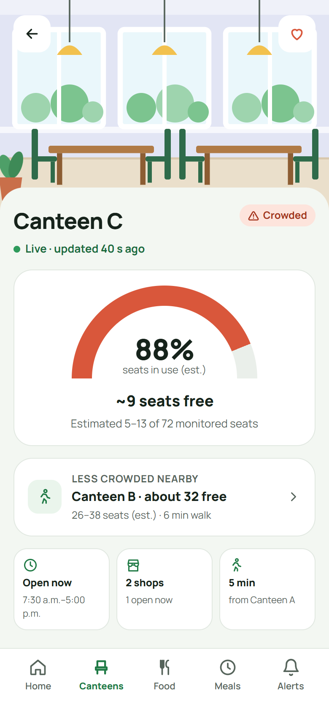
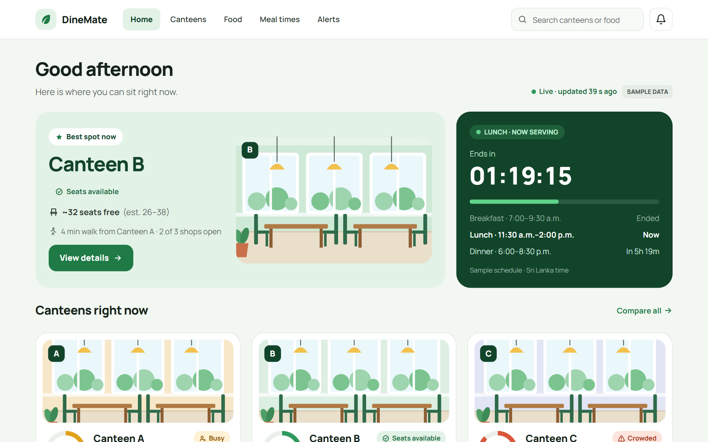
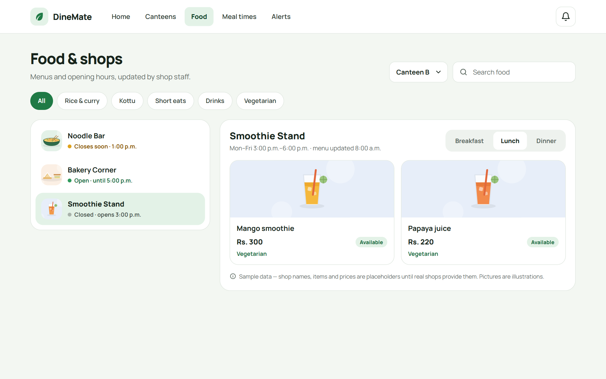
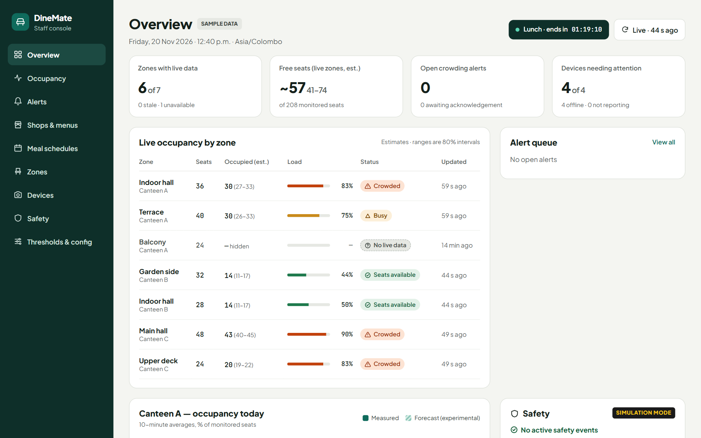
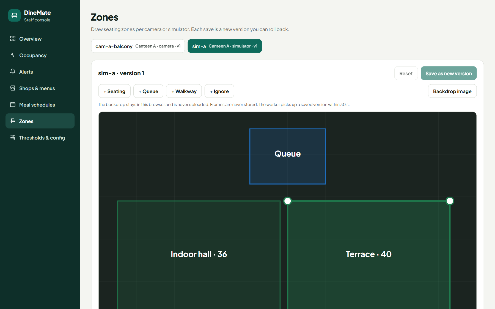
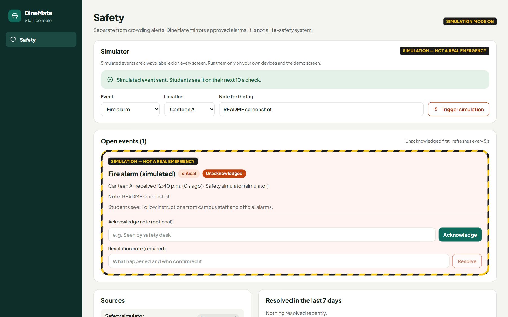
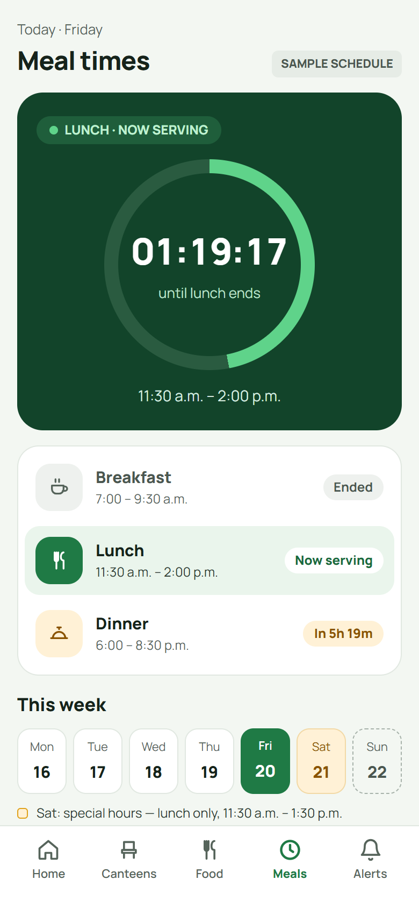

# DineMate

**Find a free canteen seat before you queue.** DineMate shows campus students roughly how many seats are free in each canteen, suggests a less crowded one nearby, and lists what each shop is serving right now. Canteen staff get a console for alerts, menus, meal times and seating zones. A separate safety module mirrors approved alarms, and every simulated alarm is clearly labelled.

> All canteens, shops, prices and people counts in this repo are **labelled sample data**. Seat numbers are always estimates ("about N", with a range). Old data is never shown as current.

<p align="center">
  
  &nbsp;
  
  &nbsp;
  
</p>

## What it does

| For students (installable PWA)                                             | For staff (console)                                                              |
| -------------------------------------------------------------------------- | -------------------------------------------------------------------------------- |
| Live "about N seats free" per canteen and zone, with a range               | Overview: live zones, crowding alerts with acknowledge, device health            |
| **Best spot now** and a **Less crowded nearby** card with walking time     | **Shops & menus**: hours, exceptions, temporary closure, menu drafts → Publish   |
| Food tab: shops open now, menus by meal, one-tap **sold out** from staff   | **Meal schedules**: campus default plus per-canteen overrides                    |
| Meal countdown that follows the server clock (a wrong phone clock is fine) | **Thresholds** per zone; **Zones** editor with versions and rollback             |
| Experimental **Next hour** forecast                                        | **Occupancy** history; **Safety** desk: acknowledge, resolve, labelled simulator |
| Safety banner; "status unknown" if the connection drops                    | Roles and scopes: admin, canteen manager, shop manager, safety officer           |

Seats are counted by a small vision worker (YOLO11n + ByteTrack). It runs on a laptop with a webcam or a recorded canteen video and **posts counts only**: no frames are stored and there is no face recognition. Canteens without a camera are fed by a labelled simulator.

## Screenshots

<table>
  <tr>
    <td width="50%"></td>
    <td width="50%"></td>
  </tr>
  <tr>
    <td align="center">Student Home: best spot, canteens, busy times</td>
    <td align="center">Food & shops: menus with sample illustrations</td>
  </tr>
  <tr>
    <td></td>
    <td></td>
  </tr>
  <tr>
    <td align="center">Console overview: zones, alerts, devices, today's chart</td>
    <td align="center">Shop manager: draft menu, inline prices, one-tap sold out</td>
  </tr>
  <tr>
    <td></td>
    <td></td>
  </tr>
  <tr>
    <td align="center">Zone editor: drag corners, save a version, roll back</td>
    <td align="center">Safety desk: every simulation is labelled</td>
  </tr>
</table>

<p align="center">
  
  &nbsp;
  
</p>

More: [canteen page with the forecast](docs/screenshots/student-canteen-laptop.png) · [occupancy history](docs/screenshots/console-occupancy.png).

## How it fits together

```text
 webcam / canteen video ──► services/vision (YOLO, counts only) ──┐
 occupancy simulator (labelled) ─────────────────────────────────┤  signed device tokens
                                                                  ▼
          apps/student (PWA)  ◄──►  services/api (FastAPI + PostgreSQL)  ◄──►  apps/console
                                     ├─ crowding rules (hysteresis, dwell)
                                     ├─ forecast (experimental baseline)
                                     └─ app/safety (separate: HMAC-signed sources only)
```

| Path                  | What                                                                                                                           |
| --------------------- | ------------------------------------------------------------------------------------------------------------------------------ |
| `apps/student`        | React 18 + Vite + Tailwind v4 PWA for students                                                                                 |
| `apps/console`        | Staff console (sign-in, roles, editing pages)                                                                                  |
| `packages/ui`         | Shared tokens and components (status pill, canteen and food illustrations, icons)                                              |
| `packages/api-client` | Typed API client and TanStack Query hooks; types are checked against the OpenAPI spec                                          |
| `services/api`        | FastAPI, SQLAlchemy 2, Alembic, PostgreSQL 16 (managed with uv, Python 3.12)                                                   |
| `services/vision`     | Seat-counting worker and zone tools ([README](services/vision/README.md))                                                      |
| `infra`               | Docker Compose: Postgres, API and simulator                                                                                    |
| `e2e`                 | Playwright demo flows, accessibility checks and README screenshots                                                             |
| `docs`                | [Plan](docs/DineMate_Development_Plan.md), [roadmap](docs/ROADMAP.md), [demo script](docs/DEMO.md), [results](docs/RESULTS.md) |

## Quick start

You need Node 24 with pnpm, Docker, and [uv](https://docs.astral.sh/uv/) (for the API and vision worker).

```bash
pnpm install
pnpm stack:up
```

This starts Postgres, the API on http://localhost:8000 and the occupancy simulator. An empty database is migrated and seeded with labelled sample data and four sample staff accounts.

```bash
pnpm dev:student:api
```

```bash
pnpm dev:console:api
```

- Student app: http://localhost:5173
- Staff console: http://localhost:5174. Sign in as `admin@dinemate.test`, `canteen.a@dinemate.test`, `rice.stall@dinemate.test` or `safety@dinemate.test`, all with the password from `DINEMATE_DEMO_PASSWORD` (see `infra/.env.example`).
- API docs: http://localhost:8000/api/v1/docs

No Docker? `pnpm dev:student` and `pnpm dev:console` run the apps on built-in sample data. The sample console accepts any password for the four sample accounts.

Optional, for the forecast and charts:

```bash
docker compose -f infra/docker-compose.yml exec api python -m app.seed_history --days 21
```

This adds three weeks of **simulated** history.

## Checks

| Command                                       | What it runs                                                                                                           |
| --------------------------------------------- | ---------------------------------------------------------------------------------------------------------------------- |
| `pnpm lint` · `pnpm typecheck` · `pnpm build` | ESLint, strict TypeScript (with API contract checks), production builds                                                |
| `pnpm test:api`                               | pytest: rules, forecast, safety, permissions; integration tests on a `dinemate_test` database                          |
| `pnpm e2e`                                    | Playwright demo flows, axe accessibility (WCAG 2.1 A/AA) and a PWA install check, on their own `dinemate_e2e` database |
| `pnpm screenshots`                            | Regenerates the images in `docs/screenshots/` from the same isolated setup                                             |
| `pnpm api:types`                              | Re-exports the OpenAPI spec and regenerates the TypeScript types after API schema changes                              |

CI runs everything except `pnpm screenshots` on every pull request.

## Principles

- **Estimates, not counts.** Every seat number has a range, goes grey after 2 minutes, and disappears after 10.
- **Privacy first.** Counts only, frames never stored, no faces or identities.
- **Safety stays separate.** Its own tables, router and permissions. Only signed messages from registered sources are accepted, and a simulator can never send a real alarm.
- **Honest sample data.** Shop names, prices and pictures are placeholders until real shops supply them. The food pictures are original illustrations, not photos.
- **Server time.** Countdowns and freshness use the server clock (Asia/Colombo), never the phone's.

## Status

Built phase by phase from [docs/ROADMAP.md](docs/ROADMAP.md). The remaining work is real-world: hand-count accuracy on canteen videos, the seat-search survey, and demo rehearsals. Results go in [docs/RESULTS.md](docs/RESULTS.md).
