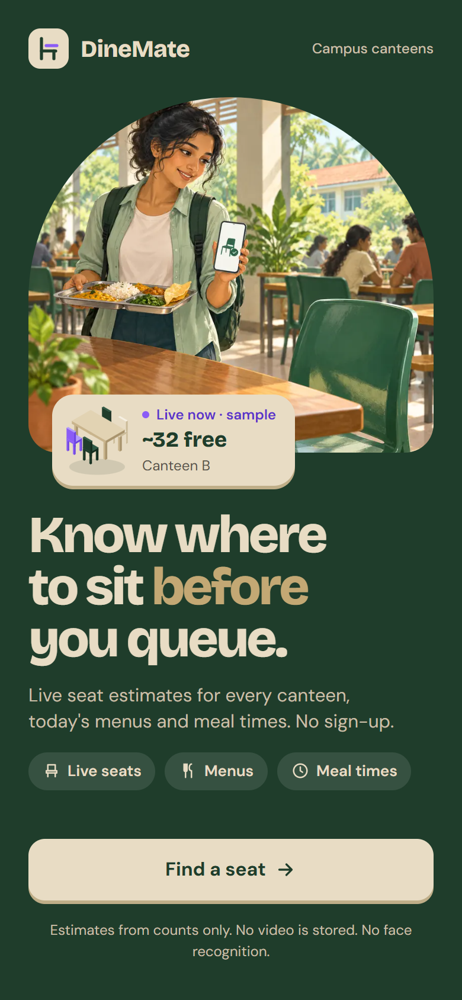
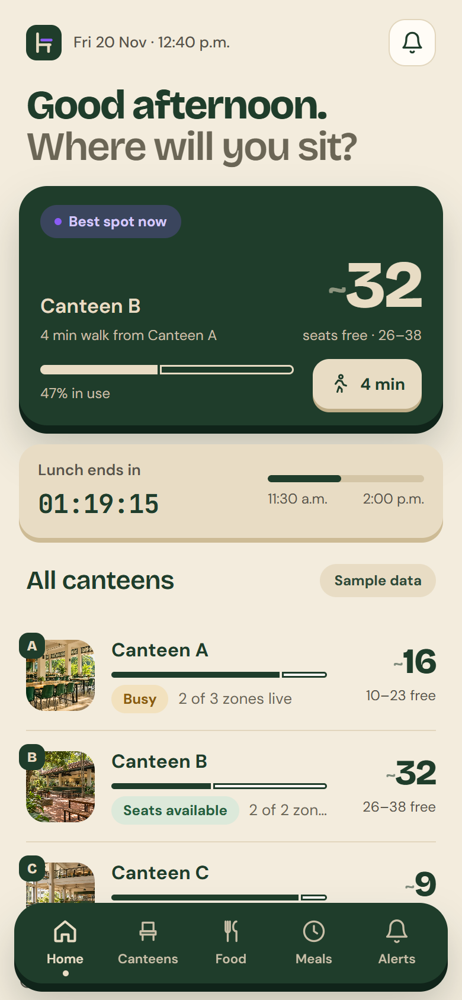
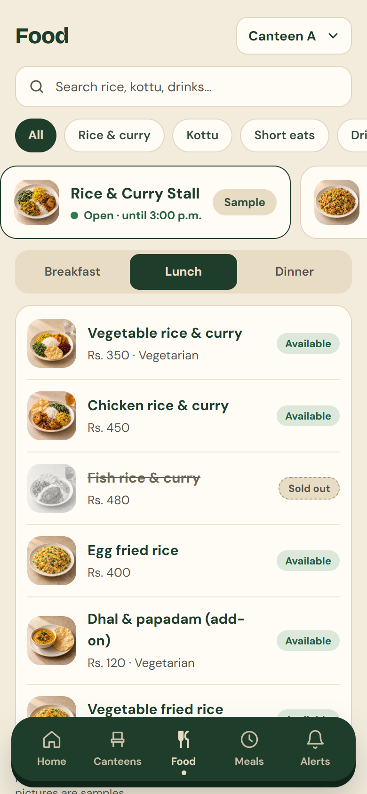
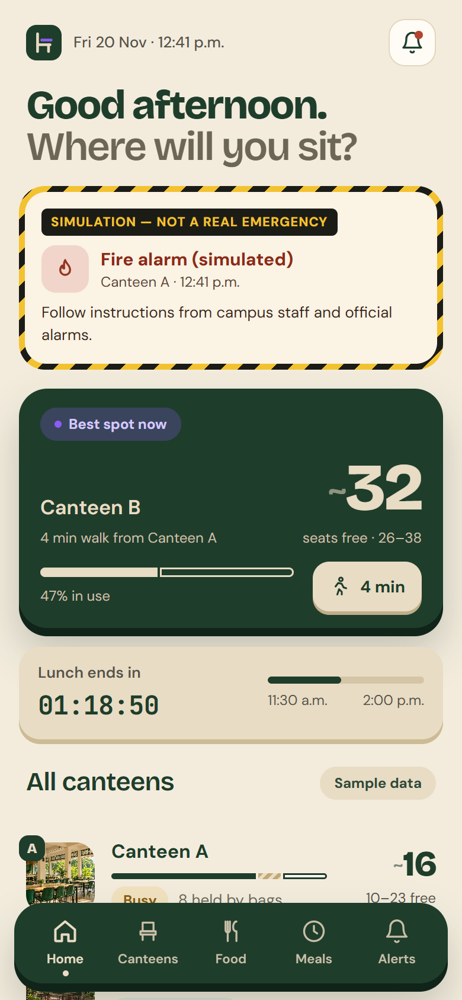
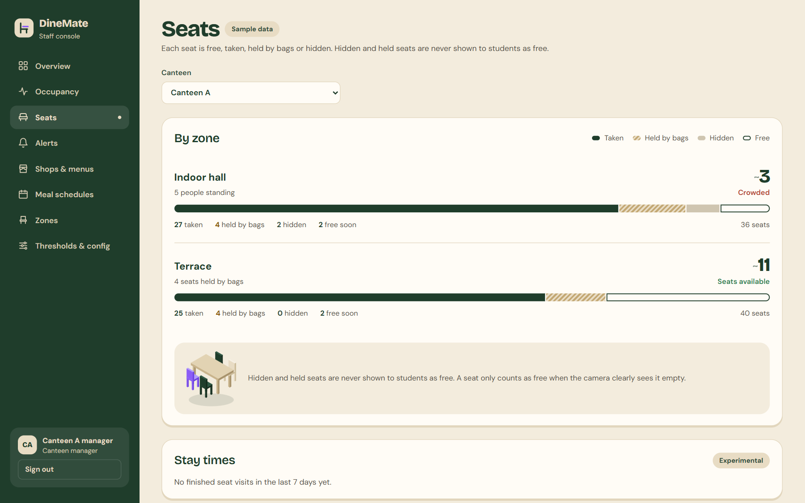
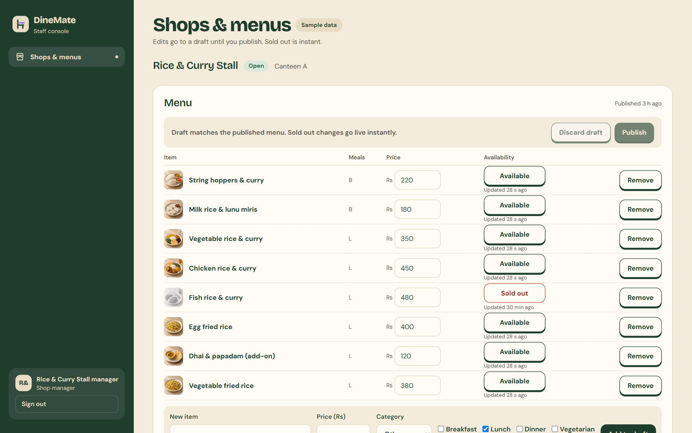
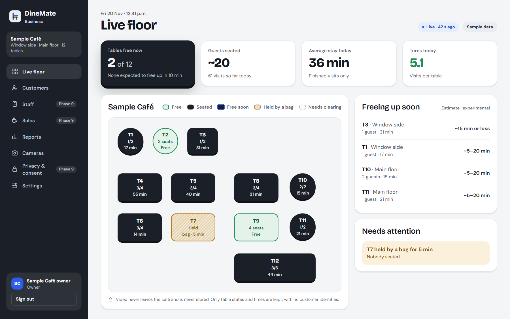
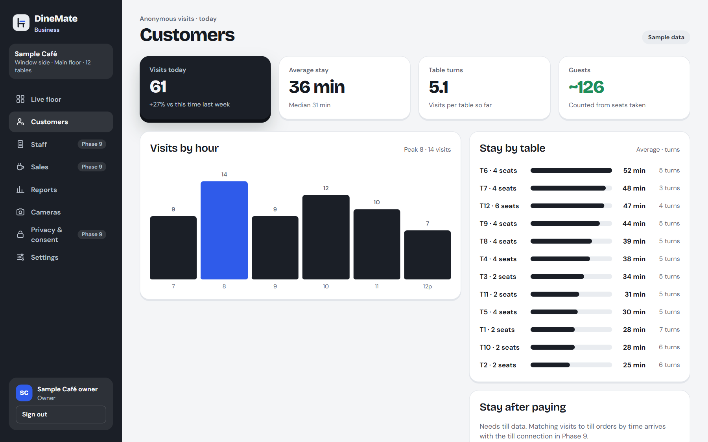
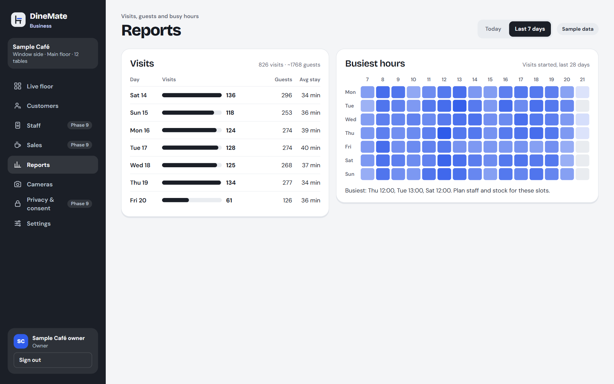
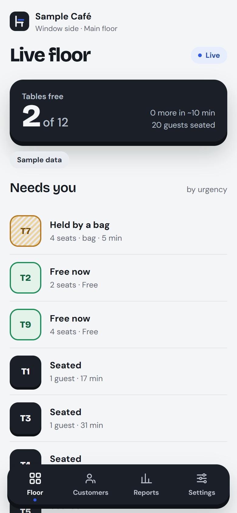

# DineMate

**Find a free canteen seat before you queue.** DineMate shows campus students roughly how many seats are free in each canteen, counting bags left on seats and hidden seats separately, suggests a less crowded canteen nearby, and lists what each shop is serving. Canteen staff get a console for alerts, seats, menus, meal times and seating zones. A separate safety module mirrors approved alarms, and every simulated alarm is clearly labelled.

**DineMate Business** is the same platform for cafés and restaurants, rented monthly: a live table map, anonymous customer visits and turn times, and a "likely free in about X–Y min" estimate per table.

> All canteens, shops, cafés, prices and people counts in this repo are **labelled sample data**. Seat numbers are always estimates ("about N", with a range). Old data is never shown as current.

<p align="center">
  
  &nbsp;
  
  &nbsp;
  
</p>

## What it does

| Students (installable PWA)                                              | Campus staff (console)                                                                  | Cafés and restaurants (DineMate Business)                                              |
| ----------------------------------------------------------------------- | --------------------------------------------------------------------------------------- | -------------------------------------------------------------------------------------- |
| "About N seats free" per canteen and zone, with a range                 | Overview: free seats, live zones, crowding alerts with acknowledge, device health       | **Live floor**: table map with free, seated, held by a bag and needs clearing          |
| Occupancy bar that shows taken, **held by bags**, hidden and free seats | **Seats**: per-zone taken, held, hidden and free-soon counts, seat maps, stay times     | **Likely free in about X–Y min** per table (experimental, from the café's own history) |
| **Best spot now** and **Less crowded nearby** with walking time         | **Shops & menus**: hours, exceptions, closures, menu drafts → Publish, one-tap sold out | **Customers**: anonymous visits, average stay, turns per table, busiest hours          |
| Food tab: shops open now, menus by meal, sold out in real time          | **Meal schedules**, **Thresholds**, **Zones** editor with seat placing and rollback     | **Reports**: day and week totals, weekday × hour grid                                  |
| Meal countdown on the server clock; experimental **next hour** forecast | **Occupancy** history; **Safety** desk with a labelled simulator                        | **Settings**: group camera seats into tables, data retention                           |
| Safety banner; "status unknown" if the connection drops                 | Roles: admin, canteen manager, shop manager, safety officer                             | Roles: owner and venue manager; Staff, Sales and Privacy arrive in Phase 9             |

Seats are counted by a small vision worker (YOLO11n + ByteTrack, plus pose for sitting vs standing). It runs on a laptop with a webcam or a recorded video and **posts numbers only**: no frames are stored and customers are never identified. Places without a camera are fed by labelled simulators.

## Screenshots

### Student app

<table>
  <tr>
    <td width="50%"></td>
    <td width="50%"></td>
  </tr>
  <tr>
    <td align="center">Home: best spot, meal countdown, every canteen at a glance</td>
    <td align="center">Food & shops: menus with sample pictures and sold-out state</td>
  </tr>
</table>

<p align="center">
  
  &nbsp;
  
  &nbsp;
  
</p>

### Staff console

<table>
  <tr>
    <td width="50%"></td>
    <td width="50%"></td>
  </tr>
  <tr>
    <td align="center">Overview: free seats, zones, alerts, devices, today's chart</td>
    <td align="center">Seats: taken, held by bags, hidden and free per zone</td>
  </tr>
  <tr>
    <td></td>
    <td></td>
  </tr>
  <tr>
    <td align="center">Shop manager: draft menu, inline prices, one-tap sold out</td>
    <td align="center">Safety desk: every simulation is labelled</td>
  </tr>
</table>

More: [zone editor](docs/screenshots/console-zones.png) · [occupancy history](docs/screenshots/console-occupancy.png) · [canteen page with the forecast](docs/screenshots/student-canteen-laptop.png).

### DineMate Business

<table>
  <tr>
    <td colspan="2"></td>
  </tr>
  <tr>
    <td colspan="2" align="center">Live floor: table states and timers, "freeing up soon" estimates, tables to clear</td>
  </tr>
  <tr>
    <td width="50%"></td>
    <td width="50%"></td>
  </tr>
  <tr>
    <td align="center">Customers: anonymous visits, stays and turns</td>
    <td align="center">Reports: daily totals and busiest hours</td>
  </tr>
</table>

<p align="center">
  
</p>

## How it fits together

```text
 webcam / video ──► services/vision (YOLO + pose, numbers only) ──┐
 campus simulator (labelled) ─────────────────────────────────────┤  signed device tokens
 café simulator (labelled, per seat) ─────────────────────────────┤
                                                                   ▼
 apps/student (PWA) ◄──► services/api (FastAPI + PostgreSQL) ◄──► apps/console
                          ├─ crowding rules, forecast (experimental)
                          ├─ seats: free, taken, held by bags, hidden
                          ├─ app/business: tables, visits, leave-time estimate ◄──► apps/business
                          └─ app/safety (separate: HMAC-signed sources only)
```

| Path                  | What                                                                                                                                          |
| --------------------- | --------------------------------------------------------------------------------------------------------------------------------------------- |
| `apps/student`        | React 18 + Vite + Tailwind v4 PWA for students                                                                                                |
| `apps/console`        | Staff console for the campus (sign-in, roles, editing pages)                                                                                  |
| `apps/business`       | DineMate Business dashboard for cafés and restaurants (desktop, tablet and a manager phone view)                                              |
| `packages/ui`         | Shared design tokens and components: occupancy bar, status chips, logo, sample canteen and food pictures, icons                               |
| `packages/api-client` | Typed API client and TanStack Query hooks with labelled sample data; types are checked against the OpenAPI spec                               |
| `services/api`        | FastAPI, SQLAlchemy 2, Alembic, PostgreSQL 16 (managed with uv, Python 3.12); `app/business/` and `app/safety/` are modules                   |
| `services/vision`     | Seat-counting worker, seat states and zone tools ([README](services/vision/README.md))                                                        |
| `infra`               | Docker Compose: Postgres, API, campus simulator and café simulator                                                                            |
| `e2e`                 | Playwright demo flows, accessibility checks and README screenshots                                                                            |
| `docs`                | [Plan](docs/DineMate_Development_Plan.md), [roadmap](docs/ROADMAP.md), [business design](docs/BUSINESS_DESIGN.md), [results](docs/RESULTS.md) |

## Quick start

You need Node 24 with pnpm, Docker, and [uv](https://docs.astral.sh/uv/) (for the API and vision worker).

```bash
pnpm install
pnpm stack:up
```

This starts Postgres, the API on http://localhost:8000 and both simulators. An empty database is migrated and seeded with labelled sample data, the Sample Café and the demo accounts.

```bash
pnpm dev:student:api
```

```bash
pnpm dev:console:api
```

```bash
pnpm dev:business:api
```

- Student app: http://localhost:5173
- Staff console: http://localhost:5174. Sign in as `admin@dinemate.test`, `canteen.a@dinemate.test`, `rice.stall@dinemate.test` or `safety@dinemate.test`.
- DineMate Business: http://localhost:5177. Sign in as `owner@dinemate.test` or `manager@dinemate.test`.
- All demo accounts use the password from `DINEMATE_DEMO_PASSWORD` (see `infra/.env.example`).
- API docs: http://localhost:8000/api/v1/docs

No Docker? `pnpm dev:student`, `pnpm dev:console` and `pnpm dev:business` run on built-in sample data, and the sample sign-in accepts any password.

Optional, for the campus forecast and charts:

```bash
docker compose -f infra/docker-compose.yml exec api python -m app.seed_history --days 21
```

This adds three weeks of **simulated** history. The Sample Café already comes with 28 days of simulated visits.

## Checks

| Command                                       | What it runs                                                                                                               |
| --------------------------------------------- | -------------------------------------------------------------------------------------------------------------------------- |
| `pnpm lint` · `pnpm typecheck` · `pnpm build` | ESLint, strict TypeScript (with API contract checks), production builds of all three apps                                  |
| `pnpm test:api`                               | pytest: rules, seats, tables, visits, estimate, forecast, safety, tenancy; integration tests on a `dinemate_test` database |
| `pnpm e2e`                                    | Playwright demo flows, axe accessibility (WCAG 2.1 A/AA) and a PWA install check, on their own `dinemate_e2e` database     |
| `pnpm screenshots`                            | Regenerates the images in `docs/screenshots/` from the same isolated setup                                                 |
| `pnpm api:types`                              | Re-exports the OpenAPI spec and regenerates the TypeScript types after API schema changes                                  |

CI runs everything except `pnpm screenshots` on every pull request.

## Principles

- **Estimates, not counts.** Every seat number has a range, goes grey after 2 minutes, and disappears after 10. Held and hidden seats are never shown as free.
- **Privacy first.** Numbers only: frames are never stored and customers are never identified. In DineMate Business a visit is a table, a start and end time and how many seats were taken.
- **Campus and business kept apart.** Each organization sees only its own venues; café data never appears in the student app or the campus console.
- **Safety stays separate.** Its own tables, router and permissions. Only signed messages from registered sources are accepted, and a simulator can never send a real alarm.
- **Honest sample data.** Shop names, prices, cafés and pictures are placeholders. The pictures are generated samples, not photos of real places or dishes.
- **Server time.** Countdowns and freshness use the server clock (Asia/Colombo), never the phone's.

## Design

Campus apps: forest, sand and purple, with Bricolage Grotesque for headings and big numbers and DM Sans for text. DineMate Business uses the same design language in graphite and cobalt ([business design](docs/BUSINESS_DESIGN.md)). Both were designed in Figma first.

## Status

Built phase by phase from [docs/ROADMAP.md](docs/ROADMAP.md). Phases 1–8 are done, including seat-level occupancy (Phase 7) and the DineMate Business core (Phase 8). Next: staff recognition with consent, till data and the live camera view (Phase 9), then deployment and pilot cafés (Phase 10). Real-world work also remains: hand-count accuracy on canteen videos, the seat-search survey and demo rehearsals. Results go in [docs/RESULTS.md](docs/RESULTS.md).
