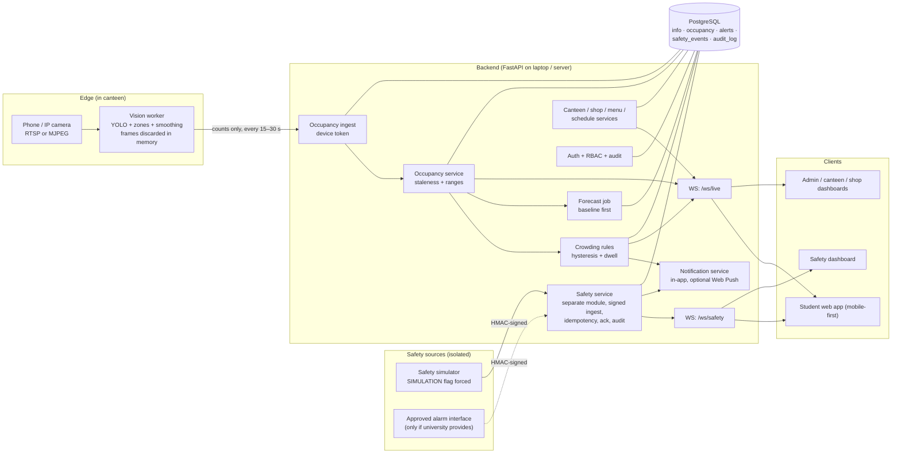
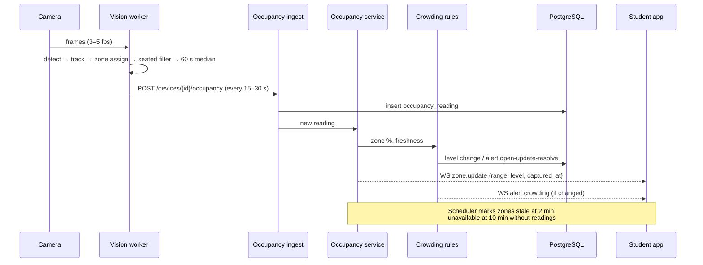
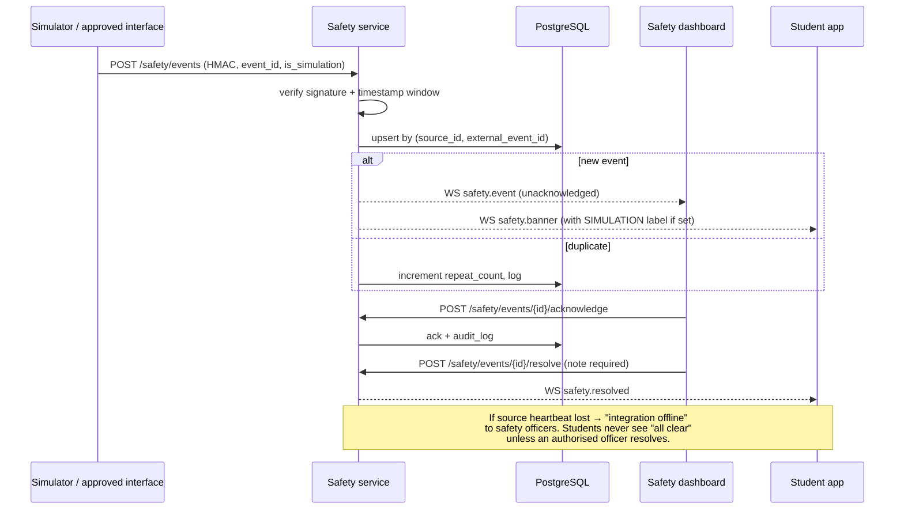
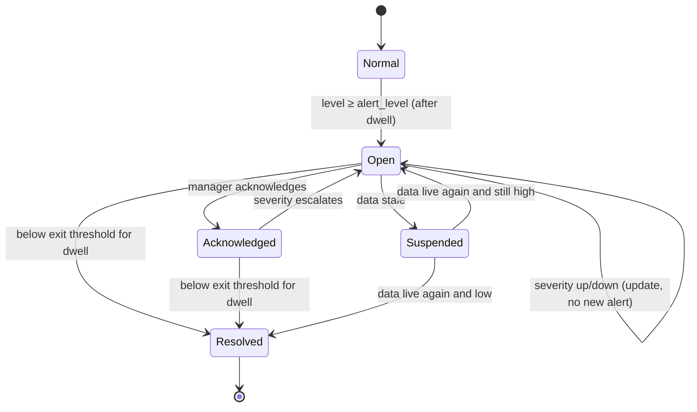
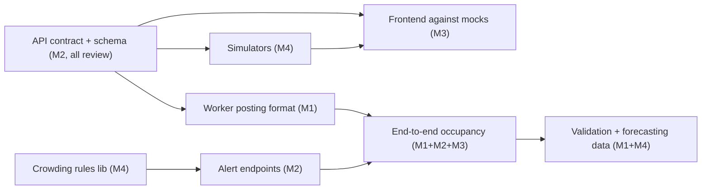

# DineMate — Development Plan

**Competition:** GreenExE 4.0 — Smart Green City (NSBM Green University)
**Team:** 4 students · **Stage:** Planning · **Plan date:** 27 October 2026 · **Version:** 2

**What changed in v2**
- Students use an **installable, mobile-first PWA** (add to home screen on phone or laptop), designed to be simple: 3 tabs, plain-language statuses, no jargon (Sections 6, 13).
- Seating zones are **already marked** for each camera; the **canteen manager can edit** zone shapes, names and capacities from the staff console (Sections 7.2, 13.6, 15).
- The web front end is split into two apps: the **student PWA** and the **staff console** (Section 23.1).
- Added **Section 27: Handover to Claude Code** — build order, conventions and the first tasks.

**Label legend used throughout**

| Label | Meaning |
|---|---|
| **[Verified]** | Checked against a cited source on 27 Oct 2026 |
| **[Estimate]** | Our approximation — confirm locally before relying on it |
| **[Assumption]** | Something we are taking as true until the university or organisers confirm |
| **[Target]** | A proposed acceptance target — not a result until testing confirms it |

---

## 1. Executive Summary

DineMate is a campus web platform that shows students **estimated** seat availability across canteens, warns them when areas are crowded, lists shops/menus/opening hours, and shows meal-period countdowns. A separate, clearly isolated safety module displays emergency alerts from an approved source — or, for the competition, from a **labelled simulator**.

**Core recommendation**

1. **Do not detect seat-by-seat.** Estimate occupancy per **seating zone** (a table group of ~8–24 seats) from camera frames, using YOLO person detection, zone polygons, a "seated" heuristic, tracking, and temporal smoothing. Show results as a range ("about 12 free, 9–15") with a freshness timestamp.
2. **Start with zero purchases.** Pilot one zone of 24–48 seats with a spare phone streaming to a team laptop. Buy one fixed Wi-Fi camera only after written permission and a validated camera view.
3. **Build the platform on simulated + recorded data first,** so web, alerts, menus, and countdowns progress in parallel with computer vision.
4. **Keep safety separate.** Different tables, endpoints, roles, WebSocket channel, and UI treatment. A student camera model is never the life-safety mechanism.
5. **Make the sustainability claim measurable,** not assumed: measure search time, utilisation balance, and (as an improvement) zone-level energy-saving opportunities.
6. **Give students a simple installable PWA.** One question answered in under 5 seconds: "Where can I sit right now?" Three tabs — Seats, Food, Alerts. Staff use a separate console.

**Stack:** React + TypeScript (Vite) · vite-plugin-pwa · FastAPI · PostgreSQL · Python/OpenCV/Ultralytics YOLO worker · WebSockets with polling fallback · Docker Compose on a laptop.

---

## 2. Problem Statement and Assumptions

**Problem.** During peak lunch (≈12:00–13:00), students who have bought food walk between canteens looking for seats. One canteen has 150+ seats, making per-seat sensors costly. Management has no data on how existing seating is used.

**What we must prove (not assume):**
- The problem is real and measurable → baseline survey + timed observations (Section 18).
- The estimator is accurate enough to be useful → manual-count validation (Section 20).

**Assumptions**

| # | Assumption | How we resolve it |
|---|---|---|
| A1 | The university may permit a camera in one canteen zone for a limited period | Written request in Week 0; fallback in Section 17.6 |
| A2 | Campus Wi-Fi may block device-to-laptop streaming | Test in Week 1; fallback to phone hotspot or wired laptop next to camera |
| A3 | Shop owners/canteen staff will update sold-out status only occasionally | Design availability as optional; show "last updated" |
| A4 | Official capacity limits and evacuation procedures are not available to us | Thresholds are configurable; safety instructions are blank until supplied by the university |
| A5 | No access to the fire alarm system | Simulator implementing an integration contract (Section 9) |
| A6 | The competition deadline is unknown | Plan is 10 weeks + Week 0; compress per Section 22 |
| A7 | Seating zones are already marked for each camera view | Seeded as the initial layout; canteen managers edit them in the staff console (Section 7.2) |
| A8 | Most students will use a phone; some will use a laptop | Mobile-first PWA that also installs on desktop Chrome/Edge (Section 13) |

---

## 3. Product Requirements and MVP Scope

### 3.1 Users
Student · Shop manager · Canteen manager · Campus administrator · Safety officer · Device (service account).

### 3.2 MoSCoW scope

| Priority | Features |
|---|---|
| **Must (MVP)** | **Installable student PWA (Seats · Food · Alerts)** · canteen-manager zone editor · live estimate for **one** pilot zone (or recorded video if no permission) · other canteens fed by a **labelled simulator** · occupancy range + freshness + stale/unavailable states · crowding levels with hysteresis and alerts + admin acknowledgement · shops, weekly hours, exceptions, temporary closure, menus, prices, sold-out · meal schedule + countdown (Asia/Colombo) · safety-alert simulator, acknowledgement, audit log · RBAC · threshold and schedule config pages |
| **Should** | Less-crowded canteen recommendation · occupancy history chart · historical-average forecast · device health dashboard · WebSocket live updates |
| **Could** | Web Push notifications · ML forecast (only if it beats baseline) · dietary filters · student feedback ("was this accurate?") · camera smoke/flame research notebook (offline only) |
| **Won't (this phase)** | Face recognition or identification · per-seat sensors · physical connection to a fire panel · food ordering/payments · total-building headcount claims |

---

## 4. Architecture

### 4.1 System diagram



**Not shown as a source on purpose:** the experimental camera smoke/flame model. It runs offline on recorded footage for research only and has no path into the safety service.

### 4.2 Components

| Component | Responsibility | Notes |
|---|---|---|
| Vision worker | Reads stream, detects people, assigns to zones, smooths, posts aggregates | Separate Python process; one per camera; never stores video |
| Occupancy ingest | Authenticates device, validates payload, stores reading | Rejects readings with timestamps >60 s in the future |
| Occupancy service | Computes availability range, level, freshness (`live`, `stale`, `unavailable`) | Single source of truth for UI status |
| Crowding rules | Level transitions with hysteresis + dwell; opens/updates/resolves alerts | One open alert per zone per type |
| Forecast job | Every 10 min, writes 15/30/60-min forecasts | Historical average + persistence baseline |
| Info services | Canteens, shops, hours, menus, meal schedules, overrides | Pure CRUD + schedule resolution |
| Notification service | Fan-out to WebSocket and optional Web Push; rate limiting | Convenience notifications only |
| Safety service | Signed ingest, dedupe, lifecycle, ack, audit, health of sources | Own router, tables, channel, permissions |
| Auth + RBAC | Login, JWT, scoped roles, audit of writes | Argon2 hashing, login rate limit |

### 4.3 Occupancy update flow



### 4.4 Emergency alert flow



### 4.5 Normal vs safety-critical separation

| Aspect | Normal features | Safety module |
|---|---|---|
| Code | `app/routers/*` | `app/safety/*` (own router, models, tests) |
| Data | `occupancy_*`, `crowding_alerts` | `safety_events`, `safety_event_acks`, `safety_sources` |
| Ingest auth | Device token | Device token **+ HMAC signature + timestamp window** |
| Who can create | Devices, rules engine | Registered safety sources only; simulator only when `SIMULATION_MODE=true` |
| Channel | `/ws/live` | `/ws/safety` |
| UI | Chips, toasts | Full-width persistent banner, `role="alert"`, cannot be swiped away while active |
| Failure behaviour | Show stale/unavailable | Show "Safety alert status unknown — follow official alarms and staff instructions" |

### 4.6 Scaling from one zone to many canteens
- Everything is keyed by `canteen → zone → device`. Adding a canteen is data, not code.
- One vision worker per camera; workers are stateless apart from their zone config (fetched from `GET /devices/{id}/config`).
- A canteen's occupancy is the sum of **covered** zones; uncovered zones are reported as "not monitored", never assumed empty.
- Scale path: laptop → small server/mini PC per building running workers → central API/DB on a campus VM. Swap WebSocket fan-out to Redis pub/sub only when running more than one API instance.

---

## 5. Hardware Comparison and Recommendation

### 5.1 Comparison (prices checked 27 Oct 2026; FX ≈ LKR 330/USD **[Verified]** — exchange-rates.org, 3 Oct 2026)

| Option | Unit cost (LKR) | Coverage per unit | Accuracy for seated people | Install complexity | Privacy | Student-team fit |
|---|---|---|---|---|---|---|
| **Spare phone/webcam + laptop** | 0 (owned) + mount ~2,000–5,000 **[Estimate]** | 1 zone, 15–40 seats **[Estimate]** | Medium; depends on angle | Low; temporary | Medium (camera) — mitigated by in-memory processing | **Best for first prototype** |
| **Wi-Fi pan/tilt camera (e.g. TP-Link Tapo C200, 1080p)** | 8,145 (buynow.lk) – 11,499 (otc.lk) **[Verified]**; similar Imou Bulb Cam 2C 3MP 7,733 **[Verified]** | 1 zone, 20–50 seats **[Estimate]** | Medium; fixed mount improves consistency | Medium; needs power + Wi-Fi | Medium | **Best for small pilot** (confirm RTSP support for the exact model before buying **[Assumption]**) |
| **PoE IP camera (wired, 2.8 mm)** | 12,000–25,000 **[Estimate]** + switch/cabling | 1 zone, 20–50 seats | Medium–high; stable stream | High; cabling, electrician | Medium | Multi-canteen phase only |
| **Thermal array (MLX90640, 32×24 px)** | US$60–75 ≈ 20,000–25,000 + shipping/duty **[Verified price; LKR estimate]** | 1–2 tables at close range **[Estimate]** | Good presence, poor counting at distance | Medium; I²C to Pi/ESP32 | **High** (no identifiable image) | Interesting privacy add-on for one table; not for 150 seats |
| **Commercial thermal camera** | Very high **[Estimate]** | Large | Good | High | High | Out of budget |
| **mmWave LD2410 (24 GHz)** | US$3–6 ≈ 1,000–2,000 + ESP32 **[Verified price; LKR estimate]** | Presence in one zone, ~6 m; **does not count people** **[Verified]** | Presence only; fans/curtains cause false positives **[Verified]** | Medium; per-table wiring + tuning | High | Useful as a per-table occupied/empty validator, not a counter |
| **mmWave LD2450** | Low **[Estimate]** | Tracks ≤3 moving targets; weak at static presence **[Verified]** | Poor for seated people | Medium | High | Not suitable alone |
| **Per-seat pressure sensors** | ~1,000–2,500 per seat incl. MCU share **[Estimate]** → 150k–375k for 150 seats | 1 seat | High | Very high (150+ installs) | High | Rejected (cost, maintenance) |
| **Entrance in/out counter** | Low–medium | Whole building | Counts entries, not seats; drifts | Medium | Medium | Future add-on for *building* occupancy (still not legal capacity) |
| **Wi-Fi/BLE device counting** | Low | Large | Poor; phones ≠ people | Low | **Poor** | Rejected (privacy, accuracy) |
| **Crowd reports by students** | 0 | Any | Unreliable | None | High | Fallback signal only |

### 5.2 Camera physics — why one camera cannot cover 150+ seats
- **Resolution vs distance.** With a wide 2.8 mm lens, a person 15 m away occupies only a few dozen pixels; detection recall drops sharply for small, partially hidden seated people. Tiling inference (e.g., SAHI) helps but costs compute.
- **Height and angle.** Mount high (≈2.5–4 m) and tilt down ≈30–50°, looking **along** table rows. Low, horizontal views cause people in front to hide everyone behind them.
- **Occlusion.** Standing people (queues, people walking) block seated people. Back-to-back seating hides one side of a table from one angle.
- **Lighting.** Windows behind tables cause backlit silhouettes; avoid pointing at windows; test at noon.
- **Queues and walkways** overlap visually with seating; must be masked out by polygons and filtered by dwell time.
- **Realistic coverage [Estimate]:** 20–50 seats per camera with acceptable accuracy → a 150-seat canteen needs **4–6 cameras**. Confirm by measuring on site.

### 5.3 Recommendation
1. **Phase 0 (no permission yet):** staged recordings — the team and volunteers seated at tables in a classroom arranged like a canteen zone. This produces labelled test video without filming the public.
2. **Phase 1 (with permission):** spare phone on a clamp mount, high in a corner, streaming to a laptop over a phone hotspot; one pilot zone of 24–48 seats.
3. **Phase 2 (only after Phase 1 validates the view):** one fixed Wi-Fi camera at the same position.
4. **Avoid Raspberry Pi purchases now:** Pi 5 prices have risen sharply due to memory costs **[Verified]**, and a laptop CPU is sufficient at 3–5 fps.

---

## 6. Technology Stack

| Layer | Choice | Why |
|---|---|---|
| Frontend | React 18 + TypeScript + Vite, React Router, TanStack Query, Tailwind CSS, Recharts (console only) | Fast dev, typed API client, good mobile UI |
| Student PWA | `vite-plugin-pwa` (Workbox): web app manifest, service worker, install prompt | Installs on Android, iPhone (Safari → Share → Add to Home Screen) and desktop Chrome/Edge without an app store |
| Monorepo | pnpm workspaces: `apps/student`, `apps/console`, `packages/ui`, `packages/api-client` | Students download a small app; staff screens stay separate |
| API client | Generated from FastAPI OpenAPI (`openapi-typescript`) | Contract stays in sync between Members 2 and 3 |
| Backend | Python 3.12, FastAPI, Pydantic v2, SQLAlchemy 2, Alembic | Same language as CV; automatic OpenAPI |
| Database | PostgreSQL 16 | Relational data, `timestamptz`, JSONB for zone polygons |
| Real-time | FastAPI WebSockets; client falls back to 15 s polling | Simple; no extra broker for one instance |
| Auth | JWT access token (15 min) + refresh token in httpOnly cookie; Argon2 | Standard, secure enough for prototype |
| CV | OpenCV, Ultralytics YOLO (nano/small) + ByteTrack, Shapely for polygons | Region counting is a documented Ultralytics solution **[Verified]** |
| Forecasting | pandas, scikit-learn (HistGradientBoosting only if justified) | Baseline first |
| Jobs | APScheduler inside API process | Staleness checks, forecasts, retention |
| Deployment | Docker Compose on a team laptop; optional small VPS for the student app | Minimal cost |
| Testing | pytest + httpx, Vitest + React Testing Library, Playwright (E2E) | Covers each layer |

**Licensing note [Verified]:** Ultralytics YOLO is AGPL-3.0 (suited to students and open projects); embedding it in a closed commercial product requires an Enterprise licence. Keep the repo open-source during the competition. If the project is later commercialised, either buy a licence or switch to an Apache-licensed detector (e.g., YOLOX — verify licence before use).

---

## 7. Computer-Vision Implementation

### 7.1 Seat-by-seat vs zone estimation

| Approach | Pros | Cons | Verdict |
|---|---|---|---|
| Seat-by-seat (chair polygons) | Precise map | Breaks with chair movement, occlusion, people sharing benches | Reject for MVP |
| **Zone/table-group counting** | Robust to chair shuffling; capacity known per zone | Less granular | **Use** |
| Table occupied/empty classification | Very robust | Doesn't give free-seat count | Use as a secondary signal for large tables |

### 7.2 Zone configuration (pre-marked, editable by the canteen manager)
Seating areas are **already marked** for each camera view. They are loaded by the seed script as layout version 1. The canteen manager can change them later from the **Zone editor** in the staff console (Section 13.6).

Each camera view holds a set of polygons:

| Polygon type | Meaning |
|---|---|
| `seating` | Table + chairs; linked to a `seating_zones` row with a name and capacity |
| `queue` | Food queue — ignored for seating |
| `walkway` | Corridors — ignored |
| `ignore` | TV screens, mirrors, posters with people |

**Storage.** Polygons are stored per camera in `zone_layouts` (versioned, JSONB, normalised 0–1 coordinates so a resolution change doesn't break them). Seating polygons reference `seating_zones.id`, where name and capacity live.

**Editing rules**
- Only a canteen manager (own canteen) or campus admin can edit.
- The editor shows a **reference image of the empty canteen** (taken with permission when no one is present) or a floor-plan sketch — never a live feed.
- Actions: move polygon points, add/delete a zone, rename, change capacity, change polygon type.
- Validation: polygons must be closed, inside the frame, not self-intersecting; seating polygons must not overlap each other; capacity 1–500.
- **Save creates a new layout version** (old versions kept for rollback); every save writes an `audit_log` row.
- The vision worker polls `GET /devices/{id}/config` every 30 s using an `ETag`. A new version is applied on the next frame, with no restart.
- Capacity changes apply to new readings only. Old readings keep their `capacity_snapshot`, so history stays correct.
- After an edit, the zone shows "Recalibrating…" to staff for 2 minutes. Students simply see the next estimate.

### 7.3 Pipeline
1. **Capture** 3–5 fps (seated occupancy changes slowly).
2. **Detect** class `person` with YOLO nano at 640 px; use 960 px or tiling only if far zones are missed.
3. **Track** with ByteTrack to get stable IDs.
4. **Anchor point:** use the bbox's upper-middle point (torso), not the bottom edge — tables hide seated people's feet.
5. **Zone assignment:** point-in-polygon against `seating` polygons; drop anything in `queue`/`walkway`/`ignore`.
6. **Seated filter:**
   - *Perspective calibration:* from a few frames, fit expected standing height `h_stand(y)` as a linear function of image row `y`.
   - Seated if bbox height < 0.7 × `h_stand(y)` **[Target, tune]**.
   - *Dwell:* count a track only after ≥20 s inside the same seating polygon — removes people walking past.
7. **Count:** `occupied_raw = min(capacity, seated_tracks)`.
8. **Smooth:** rolling median over 60 s; publish every 15–30 s.
9. **Uncertainty:** produce `[low, high]`:
   - Base band from validation residuals for that zone (empirical 80% interval).
   - Widen when (a) standing tracks overlap the seating polygon, (b) many detections have confidence < 0.4, (c) frame-to-frame variance is high.
   - Map to `confidence: high | medium | low`.
10. **Post** aggregates only. Frames stay in memory and are discarded.

### 7.4 Bags "holding" seats
CV cannot tell whether a bag means the seat is reserved. Optionally detect `backpack`/`handbag` on empty seats and report `possibly_held` count separately. Never count them as occupied.

### 7.5 Worker sketch

```python
import time
import cv2
import numpy as np
import requests
from collections import defaultdict, deque
from ultralytics import YOLO

API = "http://localhost:8000/api/v1"
DEVICE_ID = "cam-c1-z1"
TOKEN = "device-token"

cfg = requests.get(f"{API}/devices/{DEVICE_ID}/config", headers={"Authorization": f"Device {TOKEN}"}).json()
model = YOLO("yolo11n.pt")
cap = cv2.VideoCapture(cfg["stream_url"])
zones = {z["zone_id"]: z for z in cfg["zones"]}
first_seen = defaultdict(dict)
window = {zid: deque(maxlen=cfg["smooth_frames"]) for zid in zones}
last_post = 0.0

def to_px(poly, w, h):
    return np.array([[x * w, y * h] for x, y in poly], dtype=np.float32)

while True:
    ok, frame = cap.read()
    if not ok:
        time.sleep(2)
        cap = cv2.VideoCapture(cfg["stream_url"])
        continue
    h, w = frame.shape[:2]
    res = model.track(frame, persist=True, classes=[0], conf=0.25, verbose=False)[0]
    now = time.time()
    counts = {zid: 0 for zid in zones}
    if res.boxes.id is not None:
        for (x1, y1, x2, y2), tid in zip(res.boxes.xyxy.tolist(), res.boxes.id.int().tolist()):
            px, py = (x1 + x2) / 2, y1 + (y2 - y1) * 0.3
            expected = cfg["h_stand_a"] * py + cfg["h_stand_b"]
            if (y2 - y1) > 0.7 * expected:
                continue
            for zid, z in zones.items():
                if cv2.pointPolygonTest(to_px(z["polygon"], w, h), (px, py), False) >= 0:
                    t0 = first_seen[zid].setdefault(tid, now)
                    if now - t0 >= cfg["dwell_s"]:
                        counts[zid] += 1
                    break
    for zid in zones:
        window[zid].append(min(counts[zid], zones[zid]["capacity"]))
    if now - last_post >= cfg["post_every_s"]:
        readings = [
            {"zone_id": zid, "estimated_occupied": int(np.median(window[zid])), "samples": len(window[zid])}
            for zid in zones
        ]
        requests.post(
            f"{API}/devices/{DEVICE_ID}/occupancy",
            json={"captured_at": time.strftime("%Y-%m-%dT%H:%M:%SZ", time.gmtime(now)), "readings": readings},
            headers={"Authorization": f"Device {TOKEN}"},
            timeout=5,
        )
        last_post = now
```

The production version adds: track cleanup, uncertainty band, heartbeat, retry queue, and FPS/latency metrics.

### 7.6 Validation protocol
- **Ground truth:** two team members independently count occupied seats per zone every 5 minutes during sessions (11:30–14:00); disagreements >1 seat are recounted. Log in a shared sheet with timestamps synced to the server.
- **Sessions:** at least 6 sessions across quiet/peak, sunny/overcast, different days **[Target]**.
- **Metrics:** MAE (seats), bias (mean signed error), % of samples within ±2 seats, crowding-level accuracy (confusion matrix), interval coverage (% of truths inside `[low, high]`, aim ≈80%).
- **Stratify** results by crowd level and occlusion, and report the worst case honestly.

---

## 8. Occupancy and Overcrowding Logic

### 8.1 Definitions
- `capacity_z` — configured seats in zone *z* (from canteen manager).
- `occ_z` — smoothed estimate with `[low_z, high_z]`.
- `available_z = capacity_z − occ_z` (range `[capacity_z − high_z, capacity_z − low_z]`, clamped at 0).
- `pct_z = occ_z / capacity_z × 100`.
- Canteen: sum over **monitored** zones; show "X of Y zones monitored".

### 8.2 Freshness

| State | Rule | UI |
|---|---|---|
| `live` | Latest reading ≤ 2 min old | Normal display + "Updated 40 s ago" |
| `stale` | 2–10 min | Greyed numbers, "Last updated 6 min ago — may be out of date" |
| `unavailable` | >10 min, device offline, or never reported | "No live data" — **no numbers shown** |

A zone that is `stale` or `unavailable` is never shown as "normal" and never used for recommendations.

### 8.3 Crowding levels (configurable; defaults are **[Target]**)

| Level | Enter at ≥ | Exit below (hysteresis 5 pts) | Student label |
|---|---|---|---|
| Normal | — | — | "Seats available" |
| Busy | 60% | 55% | "Busy" |
| Crowded | 80% | 75% | "Crowded" |
| Near capacity | 95% | 90% | "Nearly full" |
| Unknown | stale/unavailable | — | "No live data" |

**Dwell:** a new level must persist 2 minutes before it becomes official (prevents flapping from a group sitting down then leaving).

```python
from dataclasses import dataclass
from datetime import datetime, timedelta

ORDER = ["normal", "busy", "crowded", "near_capacity"]

@dataclass
class Thresholds:
    busy: float = 60
    crowded: float = 80
    near_capacity: float = 95
    hysteresis: float = 5
    dwell: timedelta = timedelta(minutes=2)

@dataclass
class ZoneState:
    level: str = "normal"
    candidate: str | None = None
    candidate_since: datetime | None = None

def raw_level(pct: float, t: Thresholds, current: str) -> str:
    enter = {"busy": t.busy, "crowded": t.crowded, "near_capacity": t.near_capacity}
    level = "normal"
    for name in ORDER[1:]:
        limit = enter[name] - (t.hysteresis if ORDER.index(name) <= ORDER.index(current) else 0)
        if pct >= limit:
            level = name
    return level

def step(state: ZoneState, pct: float, now: datetime, t: Thresholds) -> str | None:
    target = raw_level(pct, t, state.level)
    if target == state.level:
        state.candidate = None
        return None
    if state.candidate != target:
        state.candidate, state.candidate_since = target, now
        return None
    if now - state.candidate_since >= t.dwell:
        state.level, state.candidate = target, None
        return target
    return None
```

### 8.4 Alert lifecycle (crowding)



- **One open alert per (zone, type).** Escalation updates the same record and logs a change.
- **Cooldown:** after resolve, a new alert for the same zone cannot open for 10 min unless severity reaches `near_capacity`.
- **Notification rate limit:** student-facing crowding notifications at most once per canteen per 15 min per user.
- **Stale data** suspends (doesn't resolve) the alert and raises a separate `data_stale` system alert to canteen managers.

### 8.5 Recommendations
Score each other canteen with `live` data: prefer level ≤ busy, then highest `available_low`, tie-break by configured walking minutes from the current canteen (admin-entered, not GPS). If none qualifies: "No reliable alternative right now."

### 8.6 Seating vs building occupancy
Seat estimates **cannot** establish how many people are inside a building or whether a fire-safety limit is exceeded. The UI says "seating occupancy" everywhere. Any building-capacity value shown must be supplied and approved by the university, and DineMate will not claim compliance.

### 8.7 Other alerts (convenience, never safety)

| Type | Audience | Trigger |
|---|---|---|
| `sensor_offline` | Canteen manager, admin | No heartbeat for 2 min |
| `data_stale` | Canteen manager | Zone stale while device online |
| `shop_closing_soon` | Students (opt-in) | 15 min before shop close |
| `meal_starting` | Students (opt-in) | 10 min before meal period |
| `item_sold_out` | Students viewing that shop | Manager marks sold out |

---

## 9. Emergency-Alert Design

### 9.1 Approach comparison

| | **A — Approved hardware / alarm integration** | **B — Experimental camera smoke/flame detection** |
|---|---|---|
| Source | Signal from the university's fire alarm system through an interface approved and installed by its fire-system maintainer, or a certified standalone detector | Our CV model on camera frames |
| Reliability | As reliable as the certified system feeding it | Unvalidated; false positives (steam from cooking, dust, sunlight, orange clothing) and false negatives (smoke outside view, occlusion, low light) are expected |
| Role | Mirror an authoritative signal to more screens | Research only |
| Our access | None now — needs facilities approval | Can work on public datasets/recorded videos |
| Verdict | **Design the contract now; demonstrate with simulator** | Optional offline notebook; **never connected to live alerting** |

A student-built camera model must not replace certified detection or the official alarm. DineMate is a **supplementary display**, not a life-safety system.

### 9.2 Integration contract (what an approved source would call)
We **do not invent** any vendor API. We define *our* inbound contract; if the university later provides an interface (e.g., a relay output wired by their contractor to an approved gateway), the gateway calls this endpoint.

```http
POST /api/v1/safety/events
Authorization: Device <source-token>
X-Signature: sha256=<HMAC of body using source secret>
X-Timestamp: 2026-11-20T06:42:10Z
Content-Type: application/json

{
  "external_event_id": "sim-000123",
  "event_type": "fire_alarm",
  "location": {"canteen_id": "c1", "zone_id": null},
  "occurred_at": "2026-11-20T06:42:09Z",
  "is_simulation": true
}
```

Server rules:
- Reject if signature invalid or timestamp outside ±60 s (replay protection).
- `is_simulation` is **forced true** for sources of kind `simulator`; a simulator cannot send a real event even if the payload says `false`.
- Idempotency on `(source_id, external_event_id)`; same type + location within 5 min merges into the open event (`repeat_count++`).

### 9.3 Event lifecycle and data
`received → active (unacknowledged) → acknowledged → resolved`.
- Only `safety_officer` (or `campus_admin`) can acknowledge/resolve; resolve requires a note.
- Every transition writes an append-only `audit_log` row (who, when, what, IP).
- **Severity:** `critical` (alarm), `warning` (source offline, test failure), `info` (test notice).

### 9.4 What students see
- Full-width banner with icon, text, location, time.
- Instructions: **only** text approved by the university, stored in `safety_instructions` with `approved_by` and `approved_at`. If none: "Follow instructions from campus staff and official alarms."
- **No evacuation routes or exits are shown** unless supplied and verified by the university.
- Simulation: yellow/black hatched border, persistent label **"SIMULATION — THIS IS NOT A REAL EMERGENCY"**, and every notification text is prefixed `[SIMULATION]`.

### 9.5 Failure handling

| Failure | Behaviour |
|---|---|
| Source heartbeat lost (>60 s) | `warning` event "Alarm integration offline" to safety officers |
| Student client loses `/ws/safety` | Banner: "Safety alert status unknown — follow official alarms and staff instructions"; reconnect with backoff; poll `/safety/active` every 10 s |
| Backend down | Static fallback message in the service worker; the app never displays "all clear" by default |
| Duplicate bursts | Merged; officers see repeat count, not 50 alerts |

### 9.6 Permissions needed
Written approval from the university's facilities/safety office before any real integration; written approval to run a **labelled** simulation in front of judges. The simulation is demonstrated only on the team's devices and the demo screen — never pushed to real students.

---

## 10. Shop, Menu, and Opening-Hour Management

### 10.1 Student features
Canteen details → shop list with status chips (Open / Closes soon / Closed / Temporarily closed) → shop page with today's hours, weekly hours, menu by meal period, price, availability, dietary tags (only if provided by the shop).

### 10.2 Status resolution (per shop, per moment)
1. `temporarily_closed_until` in the future → **Temporarily closed** (with reason if given).
2. Date exception for today (holiday/special hours) → use it.
3. Weekly hours for today's weekday → use them (multiple intervals allowed, e.g., 07:00–10:30 and 11:30–15:00).
4. No data → **Hours not available** (never assume open).

"Closes soon" = closing within 30 min **[Target, configurable]**.

### 10.3 Missing menu information
Show "Menu not provided yet" rather than an empty list. Items not updated for 7 days show "Last updated …".

### 10.4 Shop-manager workflow
Draft and publish: edits go to a draft; "Publish" makes them visible and writes an audit row. Sold-out toggle is instant (no draft) for speed during lunch.

### 10.5 Sample data rule
All prototype shops, prices, and hours are fictional and visibly tagged "Sample data" in the UI until real data is provided by the shop owners.

---

## 11. Meal Schedules and Countdown

### 11.1 Ownership
**Both, with precedence:** campus admin sets the campus default; a canteen manager can override for their canteen.

Resolution order for a given date: canteen date-override → canteen weekly → campus date-override → campus weekly. Shop hours are shown separately — a shop may be closed during lunch.

### 11.2 Server: compute status from schedule (not a decrementing timer)

```python
from datetime import datetime, timedelta
from zoneinfo import ZoneInfo

TZ = ZoneInfo("Asia/Colombo")

def meal_status(now_utc: datetime, periods_for_date):
    now = now_utc.astimezone(TZ)
    for offset in range(8):
        day = (now + timedelta(days=offset)).date()
        for p in sorted(periods_for_date(day), key=lambda p: p.start):
            start = datetime.combine(day, p.start, tzinfo=TZ)
            end = datetime.combine(day, p.end, tzinfo=TZ)
            if start <= now < end:
                return {"state": "active", "period": p.name, "target": end}
            if now < start:
                return {"state": "upcoming", "period": p.name, "target": start}
    return {"state": "none", "period": None, "target": None}
```

The 8-day look-ahead handles midnight, weekends, and holiday gaps. Sri Lanka currently has no daylight-saving time, but we still use `zoneinfo` rather than hard-coded `+05:30`.

### 11.3 Client: tick against server time

```ts
import { useEffect, useState } from "react";

export function useCountdown(targetIso: string | null, serverNowIso: string, receivedAtMs: number) {
  const offset = Date.parse(serverNowIso) - receivedAtMs;
  const target = targetIso ? Date.parse(targetIso) : null;
  const calc = () => (target === null ? 0 : Math.max(0, target - (Date.now() + offset)));
  const [remaining, setRemaining] = useState(calc);

  useEffect(() => {
    const tick = () => setRemaining(calc());
    const id = window.setInterval(tick, 1000);
    document.addEventListener("visibilitychange", tick);
    return () => {
      window.clearInterval(id);
      document.removeEventListener("visibilitychange", tick);
    };
  }, [target, offset]);

  return remaining;
}
```

- Refresh, new tabs, sleeping phones: the value is recomputed from `target − serverNow`, so it never restarts.
- At `remaining === 0`, refetch `/meal-status` to get the next event.
- Display: "Lunch starts in 00:18:42", or "Dinner starts at 6:00 p.m." when >6 h away.

---

## 12. AI Forecasting

### 12.1 Value
"Will there be seats in 15–30 minutes?" helps students time their purchase; managers see recurring peaks for staffing and space planning.

### 12.2 Models (in order)
1. **Persistence:** forecast = current occupancy.
2. **Historical average:** mean occupancy for (zone, weekday, 10-min slot) over past weeks.
3. **Blend:** `ŷ = α·current + (1−α)·historical`, α fitted on validation data per horizon.
4. **Gradient boosting** (scikit-learn HistGradientBoosting) — only if ≥4–6 weeks of data exist **and** it beats the blend by ≥10% MAE **[Target]**.

Features (all known at forecast time): weekday, slot, minutes since meal start, last 3 readings, lags at t−10/−20/−30 min, holiday/event flag (only if published in advance).

### 12.3 Data plan [Estimate]
Pilot zone, weekdays 11:00–14:30, readings every 30 s aggregated to 5-min means → ~42 points/day. Three to four weeks gives 600–850 points: enough to evaluate the baseline, not enough to claim a strong ML model. Say so in the presentation.

### 12.4 Evaluation
- **Time-based split:** train on earlier weeks, test on the final week. Never shuffle.
- **Leakage prevention:** features use only data before the forecast time; no "future" aggregates; scalers fitted on training data only.
- **Metrics:** MAE in seats, MAE as % of capacity, level accuracy at horizon, interval coverage.
- **Uncertainty:** empirical 80% interval from test residuals per horizon; display "Likely 10–18 free at 12:30".
- **UI wording:** "Forecast (experimental)" until the evaluation is complete.

---

## 13. UI/UX Design

Two front ends share one API and one design language:

| App | Users | Where it runs | Priority |
|---|---|---|---|
| **Student PWA** (`apps/student`) | Students | Phone first; also installs on laptops | Simplicity over features |
| **Staff console** (`apps/console`) | Shop managers, canteen managers, admins, safety officers | Laptop browser | Clarity and control |

### 13.1 Student PWA — design principles
1. **One question first.** The Seats tab answers "Where can I sit right now?" at the top, readable in under 5 seconds.
2. **Three tabs only:** **Seats · Food · Alerts.** Meal times appear as a line on the Seats tab, not a separate tab.
3. **Plain words, not percentages.** Show a status word and "about N seats free". Percentages and ranges appear only on the canteen detail page.
4. **No login for students.** Everything students see is public. Notification preferences are stored on the device.
5. **Big and calm.** Body text ≥16 px, numbers ≥28 px, tap targets ≥48 px, one accent colour, lots of white space.
6. **Honest.** Every number says "about"; a footnote says counts are estimates; missing data says "No info right now" and shows no number.

### 13.2 Student status words

| API status | Student sees | Icon | Colour (text on tint) | Rule (default thresholds, Section 8.3) |
|---|---|---|---|---|
| `plenty` | **Plenty of seats** | ✓ circle | `#1B6A3C` on `#E3F2E7` | < 60% |
| `getting_busy` | **Getting busy** | people | `#8A5300` on `#FFF1D6` | 60–80% |
| `almost_full` | **Almost full** | ⚠ triangle | `#A3321A` on `#FDE4DC` | 80–95% |
| `full` | **Full** | ⛔ | `#8F1D16` on `#FBDADA` | ≥ 95% |
| `no_info` | **No info right now** | ? | `#4A564F` on `#EEF1EE`, dashed border | stale or unavailable — never show a number |

Status is never shown by colour alone: icon + word + colour, always. Staff console keeps the technical labels (Busy, Crowded, Near capacity, Stale).

### 13.3 Student PWA screens

| # | Screen | Content (top to bottom) | Empty / error states |
|---|---|---|---|
| 0 | **Install / welcome** (first visit only) | Logo · "Find a free seat in seconds" · **Install app** button (Android/desktop uses the browser's install prompt; iPhone shows a 2-step hint: Share → Add to Home Screen) · "Continue in browser" link · privacy line ("Estimates only · no video stored") | Already installed or dismissed → skip to Seats |
| 1 | **Seats** (home) | Safety banner slot (only when active) · meal line ("Lunch · ends 2:00 p.m.") · **Best place now** card: canteen name, status word, "about 32 seats free", **Show me** button · list of all canteens: name, status word, "about N free", "updated 30 s ago" · footnote | Loading skeleton · offline: "You're offline — showing nothing until we reconnect" (never cached seat numbers) · no canteen live: "No seat info right now" |
| 2 | **Canteen detail** | Back · canteen name · big status block (word + "about 32 free" + range in small text + updated time) · **Where to sit**: each zone with status word and "about N free" · "Usually quieter after 1:30 p.m." (forecast, labelled "estimate") · **Food here** link (shops open now) · opening hours | Zone without data shows "No info right now" |
| 3 | **Food** | Canteen picker · search · shop list with Open / Closes soon / Closed · tap a shop → Breakfast/Lunch/Dinner tabs → items with price and **Available / Sold out** | "Menu not added yet" |
| 4 | **Alerts** | Safety section first (only if active; striped border; "SIMULATION — NOT A REAL EMERGENCY" when simulated) · today's notices (crowding, sold out, shop closing, meal starting) · notification switches | "No alerts today" |

### 13.4 PWA technical requirements
- **Manifest:** name "DineMate", short_name "DineMate", `display: standalone`, `theme_color` `#1F7A45`, `background_color` `#F3F7F2`, icons 192/512 px + maskable 512 px, `start_url: "/?source=pwa"`.
- **Service worker (Workbox via `vite-plugin-pwa`):**
  - Cache the app shell, fonts and icons (cache-first) so the app opens instantly and works offline as a shell.
  - **Network-only** for `/api/v1/student/summary`, occupancy, alerts and `/ws/*`. Never serve cached seat numbers as current.
  - Stale-while-revalidate for menus and shop hours (show "last updated" time).
  - `registerType: "autoUpdate"`; show a small "New version — tap to refresh" toast.
- **Install prompt:** capture `beforeinstallprompt`; show our own Install button on screen 0 and in Settings; iPhone gets the Share → Add to Home Screen hint (detect iOS Safari + not standalone).
- **Real-time:** WebSocket `/ws/live` while the app is visible; pause when hidden (`visibilitychange`); on return, refetch summary first, then reconnect. Fallback: poll every 15 s.
- **Notifications (Could):** in-app first. Web Push only after the user taps "Turn on alerts" (works on Android/desktop; iPhone only for installed PWAs on iOS 16.4+ **[Assumption — verify on test devices]**).
- **Performance targets [Target]:** first load ≤ 200 KB gzipped JS on the student app; Lighthouse PWA installable; Seats tab usable within 2 s on a mid-range Android phone on 4G.
- **Accessibility:** WCAG 2.2 AA contrast; screen-reader labels on all icons; safety banner `role="alert"`; respects reduced motion and system font size.
- **Laptop:** same app, responsive. Content centred at max 480 px for Seats/Alerts; Food uses two columns ≥ 900 px.

### 13.5 Design tokens (from the approved mockups)

| Token | Value |
|---|---|
| Font | Manrope 400/600/700/800 (Google Fonts, self-hosted for offline) |
| Brand / primary button | `#1F7A45` |
| Dark surface (meal card, header) | `#12442A` |
| Mint tint | `#E3F2E7` |
| Page background | `#F3F7F2` |
| Card | `#FFFFFF`, border `#E1E8E1`, radius 18–22 px |
| Text / muted text | `#16231B` / `#56645B` |
| Spacing scale | 4 · 8 · 12 · 16 · 20 · 24 · 32 |
| Canteen imagery | Flat illustration per canteen (replace with real photos later, with permission) |

### 13.6 Staff console pages

| # | Page | Layout & components | Loading / empty / error |
|---|---|---|---|
| 1 | Overview (admin) | KPI tiles (zones live, alerts open, devices needing attention) · live occupancy table · alert queue with Acknowledge · device health | Errors inline per widget |
| 2 | **Zone editor** (canteen manager) | Camera picker · reference image (empty canteen) with draggable polygon points · zone list (name, capacity, type) · Save (new version) · version history with Rollback | Unsaved-changes guard · conflict message if someone saved first |
| 3 | Thresholds | Per-zone sliders + numeric inputs for Busy / Crowded / Near capacity, hysteresis, dwell · preview of bands | Validation errors per field |
| 4 | Shop manager | My shops · weekly hours grid + exceptions calendar · temporary-closure toggle · menu table with inline price edit and one-tap sold-out · Publish | Unsaved-changes guard |
| 5 | Meal schedules | Campus default + canteen overrides · date overrides (holidays, special hours) | "No schedule set" |
| 6 | Safety | Active events (unacknowledged first) · Acknowledge / Resolve with note · source health · audit trail · simulator panel (simulation mode only) | Connection-lost banner |
| 7 | Users & devices (admin) | Users, roles, scopes · device tokens (create / rotate) · walking-time matrix | — |

---

## 14. Database Schema

```sql
CREATE TYPE user_role AS ENUM ('student','shop_manager','canteen_manager','campus_admin','safety_officer');
CREATE TYPE crowd_level AS ENUM ('normal','busy','crowded','near_capacity','unknown');
CREATE TYPE alert_status AS ENUM ('open','acknowledged','suspended','resolved');
CREATE TYPE safety_status AS ENUM ('active','acknowledged','resolved');
CREATE TYPE meal_period AS ENUM ('breakfast','lunch','dinner');

CREATE TABLE users (
  id uuid PRIMARY KEY DEFAULT gen_random_uuid(),
  email citext UNIQUE NOT NULL,
  password_hash text NOT NULL,
  display_name text NOT NULL,
  role user_role NOT NULL DEFAULT 'student',
  is_active boolean NOT NULL DEFAULT true,
  created_at timestamptz NOT NULL DEFAULT now()
);

CREATE TABLE canteens (
  id uuid PRIMARY KEY DEFAULT gen_random_uuid(),
  name text NOT NULL,
  location_note text,
  timezone text NOT NULL DEFAULT 'Asia/Colombo',
  is_sample boolean NOT NULL DEFAULT true
);

CREATE TABLE user_canteen_scopes (
  user_id uuid REFERENCES users(id) ON DELETE CASCADE,
  canteen_id uuid REFERENCES canteens(id) ON DELETE CASCADE,
  PRIMARY KEY (user_id, canteen_id)
);

CREATE TABLE seating_zones (
  id uuid PRIMARY KEY DEFAULT gen_random_uuid(),
  canteen_id uuid NOT NULL REFERENCES canteens(id) ON DELETE CASCADE,
  name text NOT NULL,
  capacity int NOT NULL CHECK (capacity > 0 AND capacity <= 500),
  is_monitored boolean NOT NULL DEFAULT false,
  is_active boolean NOT NULL DEFAULT true,
  updated_by uuid REFERENCES users(id),
  updated_at timestamptz NOT NULL DEFAULT now()
);

CREATE TABLE crowding_thresholds (
  zone_id uuid PRIMARY KEY REFERENCES seating_zones(id) ON DELETE CASCADE,
  busy_pct numeric(5,2) NOT NULL DEFAULT 60,
  crowded_pct numeric(5,2) NOT NULL DEFAULT 80,
  near_capacity_pct numeric(5,2) NOT NULL DEFAULT 95,
  hysteresis_pct numeric(5,2) NOT NULL DEFAULT 5,
  dwell_seconds int NOT NULL DEFAULT 120,
  alert_from crowd_level NOT NULL DEFAULT 'crowded',
  updated_by uuid REFERENCES users(id),
  updated_at timestamptz NOT NULL DEFAULT now(),
  CHECK (busy_pct < crowded_pct AND crowded_pct < near_capacity_pct AND near_capacity_pct <= 100)
);

CREATE TABLE devices (
  id text PRIMARY KEY,
  canteen_id uuid NOT NULL REFERENCES canteens(id),
  kind text NOT NULL CHECK (kind IN ('camera','simulator')),
  token_hash text NOT NULL,
  config jsonb NOT NULL DEFAULT '{}',
  last_heartbeat_at timestamptz,
  is_enabled boolean NOT NULL DEFAULT true
);

CREATE TABLE zone_layouts (
  id uuid PRIMARY KEY DEFAULT gen_random_uuid(),
  device_id text NOT NULL REFERENCES devices(id) ON DELETE CASCADE,
  version int NOT NULL,
  polygons jsonb NOT NULL,
  reference_image_url text,
  is_current boolean NOT NULL DEFAULT false,
  created_by uuid REFERENCES users(id),
  created_at timestamptz NOT NULL DEFAULT now(),
  UNIQUE (device_id, version)
);
CREATE UNIQUE INDEX one_current_layout_per_device ON zone_layouts (device_id) WHERE is_current;

CREATE TABLE device_heartbeats (
  id bigserial PRIMARY KEY,
  device_id text NOT NULL REFERENCES devices(id),
  received_at timestamptz NOT NULL DEFAULT now(),
  fps numeric(5,2),
  latency_ms int,
  status text NOT NULL,
  message text
);

CREATE TABLE occupancy_readings (
  id bigserial PRIMARY KEY,
  zone_id uuid NOT NULL REFERENCES seating_zones(id),
  device_id text NOT NULL REFERENCES devices(id),
  captured_at timestamptz NOT NULL,
  received_at timestamptz NOT NULL DEFAULT now(),
  estimated_occupied int NOT NULL CHECK (estimated_occupied >= 0),
  occupied_low int NOT NULL,
  occupied_high int NOT NULL,
  capacity_snapshot int NOT NULL,
  confidence text NOT NULL CHECK (confidence IN ('high','medium','low')),
  is_simulated boolean NOT NULL DEFAULT false,
  CHECK (occupied_low <= estimated_occupied AND estimated_occupied <= occupied_high)
);
CREATE INDEX ON occupancy_readings (zone_id, captured_at DESC);

CREATE TABLE occupancy_forecasts (
  id bigserial PRIMARY KEY,
  zone_id uuid NOT NULL REFERENCES seating_zones(id),
  generated_at timestamptz NOT NULL,
  target_time timestamptz NOT NULL,
  model text NOT NULL,
  predicted_occupied numeric(6,2) NOT NULL,
  lower numeric(6,2) NOT NULL,
  upper numeric(6,2) NOT NULL
);

CREATE TABLE crowding_alerts (
  id uuid PRIMARY KEY DEFAULT gen_random_uuid(),
  zone_id uuid NOT NULL REFERENCES seating_zones(id),
  level crowd_level NOT NULL,
  status alert_status NOT NULL DEFAULT 'open',
  opened_at timestamptz NOT NULL DEFAULT now(),
  acknowledged_by uuid REFERENCES users(id),
  acknowledged_at timestamptz,
  resolved_at timestamptz
);
CREATE UNIQUE INDEX one_open_alert_per_zone ON crowding_alerts (zone_id) WHERE status <> 'resolved';

CREATE TABLE shops (
  id uuid PRIMARY KEY DEFAULT gen_random_uuid(),
  canteen_id uuid NOT NULL REFERENCES canteens(id) ON DELETE CASCADE,
  name text NOT NULL,
  description text,
  temporarily_closed_until timestamptz,
  closure_reason text,
  is_sample boolean NOT NULL DEFAULT true,
  updated_at timestamptz NOT NULL DEFAULT now()
);

CREATE TABLE user_shop_scopes (
  user_id uuid REFERENCES users(id) ON DELETE CASCADE,
  shop_id uuid REFERENCES shops(id) ON DELETE CASCADE,
  PRIMARY KEY (user_id, shop_id)
);

CREATE TABLE shop_hours (
  id uuid PRIMARY KEY DEFAULT gen_random_uuid(),
  shop_id uuid NOT NULL REFERENCES shops(id) ON DELETE CASCADE,
  weekday smallint NOT NULL CHECK (weekday BETWEEN 0 AND 6),
  opens time NOT NULL,
  closes time NOT NULL,
  CHECK (opens < closes)
);

CREATE TABLE shop_hour_exceptions (
  id uuid PRIMARY KEY DEFAULT gen_random_uuid(),
  shop_id uuid NOT NULL REFERENCES shops(id) ON DELETE CASCADE,
  date date NOT NULL,
  is_closed boolean NOT NULL DEFAULT false,
  opens time,
  closes time,
  reason text,
  CHECK (is_closed OR (opens IS NOT NULL AND closes IS NOT NULL AND opens < closes))
);

CREATE TABLE menu_categories (
  id uuid PRIMARY KEY DEFAULT gen_random_uuid(),
  shop_id uuid NOT NULL REFERENCES shops(id) ON DELETE CASCADE,
  name text NOT NULL,
  sort_order int NOT NULL DEFAULT 0
);

CREATE TABLE menu_items (
  id uuid PRIMARY KEY DEFAULT gen_random_uuid(),
  shop_id uuid NOT NULL REFERENCES shops(id) ON DELETE CASCADE,
  category_id uuid REFERENCES menu_categories(id) ON DELETE SET NULL,
  name text NOT NULL,
  price_cents int NOT NULL CHECK (price_cents >= 0),
  dietary_tags text[] NOT NULL DEFAULT '{}',
  is_available boolean NOT NULL DEFAULT true,
  availability_updated_at timestamptz NOT NULL DEFAULT now(),
  is_published boolean NOT NULL DEFAULT false,
  updated_at timestamptz NOT NULL DEFAULT now()
);

CREATE TABLE menu_item_periods (
  item_id uuid REFERENCES menu_items(id) ON DELETE CASCADE,
  period meal_period NOT NULL,
  PRIMARY KEY (item_id, period)
);

CREATE TABLE meal_schedules (
  id uuid PRIMARY KEY DEFAULT gen_random_uuid(),
  canteen_id uuid REFERENCES canteens(id) ON DELETE CASCADE,
  weekday smallint NOT NULL CHECK (weekday BETWEEN 0 AND 6),
  period meal_period NOT NULL,
  starts time NOT NULL,
  ends time NOT NULL,
  CHECK (starts < ends)
);

CREATE TABLE schedule_overrides (
  id uuid PRIMARY KEY DEFAULT gen_random_uuid(),
  canteen_id uuid REFERENCES canteens(id) ON DELETE CASCADE,
  date date NOT NULL,
  period meal_period,
  is_cancelled boolean NOT NULL DEFAULT false,
  starts time,
  ends time,
  reason text
);

CREATE TABLE safety_sources (
  id text PRIMARY KEY,
  kind text NOT NULL CHECK (kind IN ('simulator','approved_integration')),
  secret_hash text NOT NULL,
  last_heartbeat_at timestamptz,
  is_enabled boolean NOT NULL DEFAULT true
);

CREATE TABLE safety_events (
  id uuid PRIMARY KEY DEFAULT gen_random_uuid(),
  source_id text NOT NULL REFERENCES safety_sources(id),
  external_event_id text NOT NULL,
  event_type text NOT NULL,
  severity text NOT NULL CHECK (severity IN ('critical','warning','info')),
  canteen_id uuid REFERENCES canteens(id),
  zone_id uuid REFERENCES seating_zones(id),
  occurred_at timestamptz NOT NULL,
  received_at timestamptz NOT NULL DEFAULT now(),
  is_simulation boolean NOT NULL,
  status safety_status NOT NULL DEFAULT 'active',
  repeat_count int NOT NULL DEFAULT 1,
  resolved_by uuid REFERENCES users(id),
  resolved_at timestamptz,
  resolution_note text,
  UNIQUE (source_id, external_event_id)
);

CREATE TABLE safety_event_acks (
  id bigserial PRIMARY KEY,
  event_id uuid NOT NULL REFERENCES safety_events(id),
  user_id uuid NOT NULL REFERENCES users(id),
  acknowledged_at timestamptz NOT NULL DEFAULT now(),
  note text
);

CREATE TABLE safety_instructions (
  id uuid PRIMARY KEY DEFAULT gen_random_uuid(),
  canteen_id uuid REFERENCES canteens(id),
  event_type text NOT NULL,
  body text NOT NULL,
  approved_by_name text NOT NULL,
  approved_at timestamptz NOT NULL,
  is_active boolean NOT NULL DEFAULT false
);

CREATE TABLE audit_log (
  id bigserial PRIMARY KEY,
  actor_user_id uuid REFERENCES users(id),
  actor_device_id text,
  action text NOT NULL,
  entity text NOT NULL,
  entity_id text NOT NULL,
  before jsonb,
  after jsonb,
  ip inet,
  at timestamptz NOT NULL DEFAULT now()
);

CREATE TABLE feedback (
  id bigserial PRIMARY KEY,
  user_id uuid REFERENCES users(id),
  zone_id uuid REFERENCES seating_zones(id),
  shown_level crowd_level,
  was_accurate boolean,
  comment text,
  created_at timestamptz NOT NULL DEFAULT now()
);
```

`canteen_id IS NULL` in `meal_schedules`/`schedule_overrides` = campus-wide default. `audit_log` is insert-only (revoke UPDATE/DELETE from the app role).

**Retention:** raw readings 90 days, then 15-min aggregates kept; heartbeats 30 days; audit and safety events kept for the project's lifetime.

---

## 15. API Specification

Base path `/api/v1`. All timestamps ISO-8601 UTC in requests; responses include `server_time`.

| Method | Path | Role |
|---|---|---|
| GET | `/canteens` | public |
| GET | `/canteens/{id}/occupancy` | public |
| GET | `/zones/{id}/occupancy/history?from=&to=&bucket=5m` | public |
| GET | `/recommendations?from_canteen={id}` | public |
| GET | `/canteens/{id}/shops` | public |
| GET | `/shops/{id}/menu?period=lunch` | public |
| PUT | `/shops/{id}/hours` | shop_manager (scoped), canteen_manager, admin |
| PATCH | `/menu-items/{id}/availability` | shop_manager (scoped) |
| GET | `/meal-status?canteen_id=` | public |
| GET/PUT | `/meal-schedules` | canteen_manager (own), admin (campus) |
| PUT | `/zones/{id}/thresholds` | canteen_manager (own), admin |
| GET | `/devices/{id}/layout` | canteen_manager (own), admin |
| PUT | `/devices/{id}/layout` | canteen_manager (own), admin — creates a new version |
| POST | `/devices/{id}/layout/rollback` | canteen_manager (own), admin |
| PATCH | `/zones/{id}` | canteen_manager (own), admin — name, capacity, active |
| GET | `/devices/{id}/config` | device — returns current layout with `ETag` |
| POST | `/devices/{id}/occupancy` | device |
| POST | `/devices/{id}/heartbeat` | device |
| GET | `/alerts?status=open` | canteen_manager, admin |
| POST | `/alerts/{id}/acknowledge` | canteen_manager, admin |
| POST | `/safety/events` | safety source (HMAC) |
| GET | `/safety/active` | public (students see active only) |
| POST | `/safety/events/{id}/acknowledge` | safety_officer, admin |
| POST | `/safety/events/{id}/resolve` | safety_officer, admin |
| POST | `/safety/simulate` | safety_officer, admin — only if `SIMULATION_MODE=true` |

### 15.1 Examples

**List canteens** — `GET /canteens`
```json
{
  "server_time": "2026-11-20T06:45:02Z",
  "items": [
    {
      "id": "c1",
      "name": "Sample Canteen A",
      "is_sample": true,
      "monitored_zones": 1,
      "total_zones": 6,
      "level": "crowded",
      "freshness": "live",
      "available_estimate": {"value": 7, "low": 4, "high": 10},
      "monitored_capacity": 36,
      "updated_at": "2026-11-20T06:44:41Z"
    }
  ]
}
```

**Current occupancy** — `GET /canteens/c1/occupancy`
```json
{
  "server_time": "2026-11-20T06:45:02Z",
  "canteen_id": "c1",
  "zones": [
    {
      "zone_id": "z1",
      "name": "North tables",
      "capacity": 36,
      "freshness": "live",
      "estimated_occupied": 29,
      "occupied_range": [26, 32],
      "available_range": [4, 10],
      "percent": 80.6,
      "level": "crowded",
      "confidence": "medium",
      "captured_at": "2026-11-20T06:44:41Z",
      "is_simulated": false
    },
    {
      "zone_id": "z2",
      "name": "South tables",
      "capacity": 40,
      "freshness": "unavailable",
      "level": "unknown",
      "estimated_occupied": null
    }
  ]
}
```

**History** — `GET /zones/z1/occupancy/history?from=2026-11-20T05:30:00Z&to=2026-11-20T07:30:00Z&bucket=5m`
```json
{
  "zone_id": "z1",
  "bucket": "5m",
  "points": [
    {"t": "2026-11-20T06:30:00Z", "mean": 24.2, "low": 21, "high": 27, "samples": 10},
    {"t": "2026-11-20T06:35:00Z", "mean": 27.8, "low": 25, "high": 31, "samples": 10}
  ]
}
```

**Recommendation** — `GET /recommendations?from_canteen=c1`
```json
{
  "server_time": "2026-11-20T06:45:02Z",
  "recommendation": {
    "canteen_id": "c2",
    "name": "Sample Canteen B",
    "level": "busy",
    "available_range": [12, 18],
    "walk_minutes": 4,
    "reason": "Lower crowding with live data"
  },
  "excluded": [{"canteen_id": "c3", "reason": "no_live_data"}]
}
```

**Shops** — `GET /canteens/c1/shops`
```json
{
  "items": [
    {
      "id": "s1",
      "name": "Sample Rice & Curry Stall",
      "is_sample": true,
      "status": "open",
      "closes_at_local": "15:00",
      "closes_soon": false,
      "today_hours": [{"opens": "07:00", "closes": "10:30"}, {"opens": "11:30", "closes": "15:00"}]
    }
  ]
}
```

**Menu** — `GET /shops/s1/menu?period=lunch`
```json
{
  "shop_id": "s1",
  "period": "lunch",
  "is_sample": true,
  "categories": [
    {
      "name": "Mains",
      "items": [
        {"id": "m1", "name": "Sample vegetable rice", "price_lkr": "350.00", "dietary_tags": ["vegetarian"], "is_available": false, "availability_updated_at": "2026-11-20T06:20:00Z"}
      ]
    }
  ],
  "menu_updated_at": "2026-11-19T03:00:00Z"
}
```

**Update hours** — `PUT /shops/s1/hours`
```json
{
  "weekly": [
    {"weekday": 0, "opens": "07:00", "closes": "15:00"},
    {"weekday": 1, "opens": "07:00", "closes": "15:00"}
  ],
  "exceptions": [{"date": "2026-12-25", "is_closed": true, "reason": "Holiday"}]
}
```
Response `200` with the saved object; `audit_log` row written.

**Sold out** — `PATCH /menu-items/m1/availability`
```json
{"is_available": false}
```

**Meal status** — `GET /meal-status?canteen_id=c1`
```json
{
  "server_time": "2026-11-20T06:45:02Z",
  "timezone": "Asia/Colombo",
  "state": "active",
  "period": "lunch",
  "target": "2026-11-20T08:30:00Z",
  "target_local": "2026-11-20T14:00:00+05:30",
  "source": "campus_default",
  "next": {"period": "dinner", "starts": "2026-11-20T12:30:00Z"}
}
```

**Simulated safety event** — `POST /safety/simulate`
```json
{"event_type": "fire_alarm", "canteen_id": "c1", "note": "Judging demo run 1"}
```
Response:
```json
{
  "id": "6b1f…",
  "status": "active",
  "is_simulation": true,
  "severity": "critical",
  "label": "SIMULATION — THIS IS NOT A REAL EMERGENCY",
  "received_at": "2026-11-20T06:46:10Z"
}
```

**Acknowledge** — `POST /safety/events/6b1f…/acknowledge`
```json
{"note": "Seen by safety desk"}
```

**Sensor health** — `POST /devices/cam-c1-z1/heartbeat`
```json
{"status": "ok", "fps": 4.2, "latency_ms": 310, "stream_ok": true, "message": null}
```

**Edit zone layout** — `PUT /devices/cam-c1-z1/layout` (canteen manager)
```json
{
  "base_version": 3,
  "polygons": [
    {"type": "seating", "zone_id": "z1", "points": [[0.08,0.42],[0.46,0.40],[0.48,0.92],[0.06,0.95]]},
    {"type": "seating", "zone_id": "z2", "points": [[0.52,0.40],[0.94,0.43],[0.95,0.96],[0.50,0.92]]},
    {"type": "queue", "points": [[0.40,0.10],[0.60,0.10],[0.60,0.35],[0.40,0.35]]}
  ]
}
```
Response `200`:
```json
{"device_id": "cam-c1-z1", "version": 4, "is_current": true, "created_at": "2026-11-20T03:12:00Z"}
```
`409 conflict` if `base_version` is not the current version (someone else saved first). `422` if polygons are invalid or seating polygons overlap.

**Student PWA summary** — `GET /student/summary` (public; one call powers the Seats tab)
```json
{
  "server_time": "2026-11-20T07:11:02Z",
  "meal": {"state": "active", "period": "lunch", "ends_at": "2026-11-20T08:30:00Z"},
  "best": {"canteen_id": "c2", "name": "Canteen B", "status": "plenty", "free_about": 32},
  "canteens": [
    {"id": "c1", "name": "Canteen A", "status": "getting_busy", "free_about": 16, "free_range": [10, 23], "updated_at": "2026-11-20T07:10:22Z"},
    {"id": "c2", "name": "Canteen B", "status": "plenty", "free_about": 32, "free_range": [26, 38], "updated_at": "2026-11-20T07:10:37Z"},
    {"id": "c3", "name": "Canteen C", "status": "no_info", "free_about": null, "free_range": null, "updated_at": "2026-11-20T06:57:10Z"}
  ],
  "safety": {"active": false}
}
```

### 15.2 Errors, validation, authorisation
- Error body (all endpoints):
```json
{"error": {"code": "forbidden_scope", "message": "You can only edit shops assigned to you.", "details": {"shop_id": "s9"}}, "request_id": "req_7f2c"}
```
- Codes: `400 validation_error`, `401 unauthenticated`, `403 forbidden` / `forbidden_scope`, `404 not_found`, `409 conflict` (e.g., overlapping hours, stale `If-Match`), `422` Pydantic details, `429 rate_limited`.
- Pydantic validation: times `HH:MM`, `opens < closes`, no overlapping intervals per weekday, price 0–100,000 LKR, capacity 1–500, threshold ordering enforced.
- **Authorisation** is checked in a dependency that loads the user's role **and scope** (shop/canteen) — never trust IDs from the client alone.
- Optimistic concurrency: `ETag`/`If-Match` on shop/menu/schedule updates.
- Devices: per-device token (hashed in DB), rotated by admin; a device can only post to its own zones.
- Rate limits: login 5/min/IP; writes 60/min/user; safety ingest 10/s/source.

---

## 16. Roles and Permissions

| Capability | Student | Shop mgr | Canteen mgr | Campus admin | Safety officer |
|---|---|---|---|---|---|
| View occupancy, shops, menus, meals, active safety alerts | ✓ | ✓ | ✓ | ✓ | ✓ |
| Edit own shop details, hours, menu, sold-out | — | ✓ (scoped) | ✓ (own canteen) | ✓ | — |
| Create/delete shops in a canteen | — | — | ✓ (own) | ✓ | — |
| Edit zones, capacities, thresholds | — | — | ✓ (own) | ✓ | — |
| Canteen meal-schedule overrides | — | — | ✓ (own) | ✓ | — |
| Campus meal schedule | — | — | — | ✓ | — |
| Acknowledge crowding alerts | — | — | ✓ (own) | ✓ | — |
| Manage users, roles, devices | — | — | — | ✓ | — |
| View/ack/resolve safety events, view audit | — | — | — | ✓ | ✓ |
| Trigger **simulated** safety event | — | — | — | ✓ (sim mode) | ✓ (sim mode) |
| Edit approved safety instructions | — | — | — | ✓ (with approval record) | ✓ (with approval record) |
| Create a real safety event | — | — | — | — | — (only approved sources) |

Admin and safety accounts: strong passwords, TOTP 2FA (Could → Should if time permits), session timeout 30 min.

---

## 17. Privacy and Safety

### 17.1 Permissions first
- Written approval from the university (administration + facilities + whoever governs CCTV/data) **before** any camera is placed. Include: location, duration, purpose, no recording, contact person.
- Visible notice at the pilot zone: "Seat-occupancy sensor in testing. No recording, no face recognition. Contact: …"
- Check the university's data/CCTV policy and Sri Lanka's Personal Data Protection Act No. 9 of 2022 with the university's legal or data-protection office **[Assumption — not legal advice; confirm current applicability]**.

### 17.2 Data minimisation
- Process frames locally, in memory; store only counts.
- No face recognition, re-identification, or person attributes.
- Calibration snapshots (needed to draw polygons): taken when the area is empty if possible; otherwise blurred automatically; deleted within 7 days.
- Validation footage (if the university allows short recording): blurred, encrypted, access-limited to Member 1, deleted after validation — or skip and use live manual counts.

### 17.3 Security
Argon2 passwords, HTTPS for anything off-laptop, JWT short expiry, CORS allow-list, parameterised queries via ORM, input validation everywhere, secrets in `.env` (not in git), dependency scanning (`pip-audit`, `npm audit`), audit log for all writes.

### 17.4 Safety rules (summary)
Students can't create official alerts; simulated alerts are labelled everywhere; no invented exits, routes, thresholds, or APIs; real integration only through an approved interface installed by authorised personnel.

### 17.5 When camera data is unavailable
Zone → `stale` (grey, timestamp) → `unavailable` (no numbers). Recommendations ignore it. Crowding alert suspends. Canteen manager gets `data_stale`/`sensor_offline`. Old data is never shown as current.

### 17.6 If camera installation is not permitted
1. Staged recordings in a classroom with consenting volunteers (validates CV).
2. Occupancy simulator driving the live platform (clearly marked `is_simulated`).
3. Optional privacy-preserving sensing for one table (MLX90640 or LD2410) if facilities agree.
4. Manual counts by the team entered through an admin "manual reading" form to show the real data flow.

---

## 18. Sustainability Strategy

### 18.1 Honest assessment

| Type | Claim | Evidence needed |
|---|---|---|
| **Direct environmental** | Very small (less walking is not a measurable emissions cut) | Don't claim |
| **Indirect — space efficiency** | Utilisation data can show whether existing seating is enough before anyone builds more | Utilisation curves over weeks; management decision process |
| **Indirect — time & comfort** | Less time searching for seats | Before/after search-time measurement |
| **Indirect — food planning** | Peak forecasts + sold-out data could help shops prepare quantities closer to demand | Shop-recorded unsold quantities before/after — not in MVP |

**Biggest weakness:** no direct, measurable environmental outcome. Judges in a "green city" competition will notice.

**Concrete improvements**
1. **Occupancy-driven energy insight (recommended add-on):** zone-level data identifies times when entire zones are empty while fans/lights are on. Produce an "energy opportunity" report (hours of empty-zone operation). With facilities' permission, measure one fan/light circuit with a smart energy plug for a week to quantify kWh at stake. Do not automate switching in the prototype.
2. **Food-waste pilot (Could):** one willing shop logs unsold portions daily for 2 weeks with and without access to peak forecasts. Report honestly even if no effect.
3. **Infrastructure planning evidence:** a "seat-hours used vs available" dashboard per canteen per week.

### 18.2 Measurements

| Metric | Method | When |
|---|---|---|
| Seat-search time | Short survey (n ≥ 50 **[Target]**) + timed observation of students leaving the counter until seated (n ≥ 30 per condition) | Baseline Week 1–2; again with app in Week 8–9 |
| Walking between canteens | Observation at canteen exits during peak + survey question | Same |
| Occupancy accuracy | Section 7.6 | Weeks 5, 8 |
| Forecast accuracy | Section 12.4 | Week 8 |
| Utilisation balance | Coefficient of variation of % occupancy across zones/canteens at peak | Weekly (needs ≥2 monitored areas; otherwise report per-zone peak/average ratio) |
| Energy opportunity | Empty-zone hours × measured circuit power | Week 7–9 (if permitted) |

Note: behaviour change from a 2–3 week pilot will be small and confounded; present it as a pilot result with limitations.

### 18.3 Competition information **[Verified]**
- GreenExE 4.0 is run by the Association of Software Engineering (ASE) at NSBM, for teams of 2–5 students; Member 1 is the team leader.
- Registration collects title, category (options include "Connected Digital Services", "Smart Buildings & Infrastructure", "Smart Energy"), problem, solution, technology, innovation, expected impact.
- The site says eligibility, submission/presentation requirements, and final rules are confirmed by organisers; **no rubric, deadline, or prize details are published** as of 27 Oct 2026.
- Contact: ase@nsbm.ac.lk.

**Suggested category:** Connected Digital Services (primary), framed with Smart Buildings & Infrastructure benefits. Confirm with organisers whether multi-category framing is allowed.

### 18.4 Questions for the organisers
1. Key dates: registration close, proposal submission, rounds, final?
2. Judging rubric and weighting (innovation, impact, technical depth, sustainability, presentation)?
3. Is a working prototype expected, or is a concept + demo acceptable for early rounds?
4. Live demo allowed? Can we bring hardware, use venue Wi-Fi/power?
5. Presentation length and format; Q&A length?
6. Can we use open-source models (AGPL) and AI coding assistants? Disclosure rules?
7. Who owns the IP of submitted projects?
8. Can ASE help us obtain permission for a camera pilot in a canteen?
9. Can a project be submitted under more than one category?
10. Is there a required sustainability evidence or reporting format?

---

## 19. Budget (LKR)

Prices checked 27 Oct 2026. Treat all as estimates until confirmed with local sellers.

### Scenario 1 — Minimum-cost prototype (existing equipment)

| Item | Cost |
|---|---|
| Spare Android phone + team laptop | 0 (owned) |
| Clamp/tripod phone mount | 2,000–5,000 **[Estimate]** |
| Extension cord / power bank | 1,500–3,000 **[Estimate]** |
| Networking (phone hotspot, existing data) | 0–1,000 **[Estimate]** |
| Hosting (laptop, Docker) | 0 |
| **Total** | **≈ 3,500–9,000** |

### Scenario 2 — Small pilot (one fixed camera)

| Item | Cost |
|---|---|
| Scenario 1 items | 3,500–9,000 |
| Wi-Fi camera (Tapo C200 class) | 8,145–11,499 **[Verified, buynow.lk / otc.lk]** |
| Mounting bracket, cable clips, extension | 3,000–8,000 **[Estimate]** |
| Network: approved campus Wi-Fi, or small 4G router + data | 0 or 8,000–15,000 + data **[Estimate]** |
| Optional small VPS for student app (per month) | 2,000–5,000 **[Estimate]** |
| **Total (one-off)** | **≈ 15,000–45,000** |

### Scenario 3 — Multi-canteen deployment (3 canteens, ~12–15 cameras) — order of magnitude only

| Category | Items | Cost |
|---|---|---|
| Hardware | 12–15 PoE IP cameras | 145,000–375,000 **[Estimate]** |
| Networking | 2–3 PoE switches, cabling | 50,000–150,000 **[Estimate]** |
| Mounting & installation | Contractor/electrician | 100,000–300,000 **[Estimate]** |
| Compute | Edge mini PC(s) or GPU workstation for CV | 150,000–400,000 **[Estimate]** |
| Power | UPS | 20,000–50,000 **[Estimate]** |
| Hosting | Campus VM or VPS | 3,000–10,000 / month **[Estimate]** |
| Maintenance | Camera cleaning, re-calibration, replacements, updates | ~10–15% of hardware per year **[Estimate]** |
| Licensing | Ultralytics Enterprise if closed-source/commercial, or switch model | Quote required |
| **Total one-off** | | **≈ 0.5–1.3 million** + recurring |

**Do not buy anything** until: (1) written university permission, (2) the phone prototype proves the view works from the chosen mounting position, (3) validation shows acceptable accuracy.

---

## 20. Testing and Acceptance Criteria

All numbers are **[Target]** until confirmed.

### Occupancy
| Test | Method | Target |
|---|---|---|
| Accuracy | Manual counts vs estimate, ≥6 sessions | MAE ≤ 3 seats for a 24–48-seat zone; ≥80% of samples within ±3 |
| Level accuracy | Confusion matrix | ≥85% correct level |
| Interval coverage | Truth inside `[low, high]` | 70–90% |
| Conditions | Quiet vs peak, bright vs overcast, queue present, camera angle A vs B | Report each; no hidden cherry-picking |
| Latency | Seat change → UI | ≤ 60 s (given 60 s smoothing + 30 s post) |
| Stale handling | Stop worker | `stale` at 2 min, `unavailable` at 10 min, numbers hidden |

### Overcrowding alerts
| Test | Target |
|---|---|
| Threshold changes take effect on next reading | 100% |
| Flapping input (oscillating ±3% around threshold for 1 h) | 0 duplicate alerts; ≤1 level change per dwell period |
| Escalation and recovery | Same alert updates; resolves after dwell below exit threshold |
| Stale data during alert | Alert suspended, never shows "normal" |
| Student notification rate limit | ≤1 per canteen per 15 min |

### Emergency alerts (simulation only — no real fire tests)
| Test | Target |
|---|---|
| Simulated event displayed on safety dashboard | ≤ 5 s on LAN |
| Simulation label present on every surface (banner, notification, dashboard, audit) | 100% |
| Simulator payload with `is_simulation=false` | Stored as simulation |
| Invalid signature / replayed timestamp | Rejected, logged |
| Duplicate burst (50 events, same id/location) | 1 event, `repeat_count=50` |
| Ack/resolve recorded with user + time | 100% |
| Source heartbeat lost | Offline warning ≤ 90 s |
| Client WS disconnect | "Status unknown" banner ≤ 15 s |

### Shops & menus
Opening hours incl. split shifts, exceptions, temporary closure precedence, "closes soon", sold-out instant update, price validation, shop manager blocked from other shops (403), publish/draft visibility.

### Meal countdown
Transitions at start/end (±1 s), midnight rollover, weekend gap, holiday override, canteen override precedence, page refresh mid-countdown (no reset), two tabs agree within 1 s, device clock wrong by 10 min (still correct via server offset), Asia/Colombo display.

### Student PWA
Installs on Android Chrome, iPhone Safari (Add to Home Screen) and desktop Chrome/Edge · opens offline as a shell and shows "You're offline" instead of seat numbers · never shows cached occupancy · status words match thresholds · Lighthouse PWA "installable" passes · 5-second test: 5 students who have never seen the app find the best canteen within 5 s **[Target]** · usable at 200% system font size.

### Zone editor
Only the canteen's own manager or an admin can save (403 otherwise) · overlapping or self-intersecting polygons rejected (422) · concurrent save returns 409 · rollback restores the previous version · worker applies a new layout within 30 s without restart · capacity change does not alter historical readings.

### Security & reliability
Unauthenticated writes → 401; wrong role → 403; scope violation → 403; SQL-injection/XSS payloads rejected or escaped; rate limits enforced; device token for zone A cannot post zone B; API down → frontend error states; DB restart recovery.

### Test layers
pytest (rules engine, schedule resolution, permissions) ≥80% coverage on `rules`, `schedule`, `safety` modules · Vitest for countdown/status components · Playwright E2E for 5 key flows · manual exploratory test on 3 phones.

---

## 21. Four-Member Task Allocation

| Member | Owns | Also supports |
|---|---|---|
| **M1 — CV & sensing** | Camera tests, staged recordings, zone polygon tool, vision worker, seated heuristic, smoothing, uncertainty, heartbeat, validation sessions | Privacy notice, hardware decisions |
| **M2 — Backend & DB** | Schema + migrations, auth/RBAC, all REST endpoints, WebSockets, schedule resolution, safety service, audit, retention jobs | API contract owner, security tests |
| **M3 — Frontend & UX** | Design system, student pages, admin/shop/safety dashboards, config pages, accessibility, PWA shell | Usability testing, demo visuals |
| **M4 — Forecasting, rules, testing, integration** | Occupancy & safety simulators, crowding state machine (pure Python lib used by M2), forecast job, test plan, E2E, sustainability measurements, docs, competition submission | Integration lead, timeline tracking |

### Dependencies


### Shared milestones
| ID | End of | Definition of done |
|---|---|---|
| M1 | Week 2 | OpenAPI contract + DB schema frozen (changes need team approval); frontend runs on mock server; simulators post data |
| M2 | Week 4 | Recorded video → worker → API → live UI, end-to-end |
| M3 | Week 6 | All four modules + safety simulator working on simulated/recorded data |
| M4 | Week 8 | Live pilot validated (or documented fallback); forecast baseline evaluated |
| M5 | Week 10 | Feature freeze, demo rehearsed twice, recorded backup demo |

**Working agreements:** trunk-based with short PR branches; 1 reviewer per PR; CI runs tests + lint; 15-min stand-up 3×/week; integration day every Friday.

---

## 22. Week-by-Week Timeline

Assumes start **Mon 2 Nov 2026**, 10 weeks + Week 0. If the official deadline is earlier, compress by: merging Weeks 7–8, dropping forecasting to a stub, and skipping Scenario 2 hardware. Adjust around exams.

**Week 0 (27 Oct – 1 Nov) — Setup & permissions**
- Objectives: permissions requested, competition registered, questions sent.
- Tasks: permission letter (M4 drafts, all sign); register on GreenExE site (M4); email organiser questions (M4); repo + CI + Docker Compose skeleton (M2); wireframe sketches (M3); camera test plan + staged-recording plan (M1).
- Deliverables: sent letters/emails, empty repo with CI.
- Risks/fallback: no reply → follow up in person via ASE and lecturer-in-charge.

**Week 1 (2–8 Nov) — Foundations**
- M1: staged recordings (2 angles, 3 crowd levels); test phone streaming over hotspot.
- M2: schema v1 + Alembic; auth skeleton; OpenAPI draft.
- M3: design tokens, status components, page wireframes in Figma.
- M4: occupancy simulator; baseline survey launched; observation protocol.
- Deliverables: draft contract, recordings, wireframes, survey live.
- Tests: CI green; schema migrations up/down.
- Risk: Wi-Fi blocks streams → hotspot or worker on laptop next to camera.

**Week 2 (9–15 Nov) — Contract freeze (Milestone M1)**
- M1: YOLO detection on recordings; polygon drawing tool.
- M2: canteen/shop/menu/hours CRUD; RBAC scopes.
- M3: student PWA shell (manifest, service worker, install screen), Seats tab on mock API.
- M4: crowding state machine library + unit tests; safety simulator CLI.
- Deliverables: frozen contract, mock server, rules library.
- Tests: rules unit tests (flapping, dwell, stale).

**Week 3 (16–22 Nov) — Occupancy core**
- M1: tracking, seated filter, dwell, smoothing.
- M2: device tokens, occupancy ingest, freshness scheduler, WebSocket `/ws/live`.
- M3: canteen details, zone tiles, stale/unavailable states.
- M4: integrate rules lib into backend with M2; first permission follow-up.
- Tests: ingest validation, freshness transitions.
- Risk: CV accuracy poor on recordings → simplify to table occupied/empty + adjust angle.

**Week 4 (23–29 Nov) — End-to-end (Milestone M2)**
- All: recorded video → worker → API → UI live.
- M1: uncertainty band v1; heartbeat.
- M2: alerts endpoints, acknowledgement, notification rate limiting.
- M3: alerts page, admin alert queue.
- M4: Playwright E2E for occupancy flow.
- Deliverable: demoable occupancy loop.

**Week 5 (30 Nov – 6 Dec) — Information modules**
- M2: meal schedules, overrides, `/meal-status`; shop status resolution.
- M3: student Food tab, meal line on Seats, canteen detail; console shop-manager page and Zone editor.
- M1: first validation session (staged or live if permitted).
- M4: schedule tests (midnight, holiday, refresh); seed sample data clearly labelled.
- Tests: countdown suite; permission tests for shop managers.

**Week 6 (7–13 Dec) — Safety & config (Milestone M3)**
- M2: safety service (HMAC, idempotency, ack/resolve, audit), `/ws/safety`.
- M3: safety banner, simulation styling, safety dashboard, config pages.
- M4: safety test suite; simulator integration; device-health dashboard data.
- M1: camera mounting dry run (if permission granted).
- Deliverable: all modules on simulated/recorded data.

**Week 7 (14–20 Dec) — Live pilot**
- M1: live pilot in canteen zone during lunch (permission dependent); daily health checks.
- M4 + M1: manual-count validation sessions.
- M2: security hardening, rate limits, retention jobs.
- M3: accessibility pass, loading/empty/error states.
- Risk: no permission → staged pilot + simulator; document clearly.

**Week 8 (21–27 Dec) — Evaluate (Milestone M4)**
- M4: forecasting baseline + evaluation; accuracy report; post-survey.
- M1: tune thresholds from validation; final accuracy numbers.
- M2: recommendation endpoint; history endpoint optimisation.
- M3: history chart, forecast strip (experimental label), recommendation card.
- Note: holiday period may reduce canteen traffic — collect data earlier if possible.

**Week 9 (28 Dec – 3 Jan) — Integration & presentation**
- All: bug bash, E2E regression, 3-device manual test.
- M4: sustainability analysis, slides draft, demo script.
- M3: demo polish, screenshots.
- M1: record backup demo video (blurred where needed).

**Week 10 (4–10 Jan) — Freeze (Milestone M5)**
- Feature freeze Monday; rehearse twice; judge Q&A drill; final docs (README, architecture, privacy statement, test report).
- Fallback: recorded demo + local Docker on a second laptop.

---

## 23. Step-by-Step Implementation Roadmap

### 23.1 Repository structure
```text
dinemate/
├── apps/
│   ├── student/              React + TS PWA (Vite + vite-plugin-pwa)
│   │   ├── public/           manifest icons
│   │   └── src/              screens: Welcome, Seats, CanteenDetail, Food, Alerts
│   └── console/              React + TS staff console
│       └── src/features/     overview, zone-editor, thresholds, shops, schedules, safety, users
├── packages/
│   ├── ui/                   shared tokens + components (StatusPill, Card, Button, Banner)
│   └── api-client/           generated from FastAPI OpenAPI
├── services/
│   ├── api/                  FastAPI
│   │   ├── app/core/         config, security, db
│   │   ├── app/models/
│   │   ├── app/routers/      canteens, shops, menus, schedules, occupancy, alerts, devices, auth
│   │   ├── app/safety/       router, models, service, signatures
│   │   ├── app/rules/        crowding state machine
│   │   ├── app/jobs/         freshness, forecasts, retention
│   │   ├── alembic/
│   │   └── tests/
│   └── vision/               worker, calibration, polygon tool, validation scripts
├── tools/
│   ├── occupancy_simulator/
│   └── safety_simulator/
├── research/
│   └── smoke_flame_offline/  notebooks only; no runtime link
├── infra/
│   ├── docker-compose.yml
│   └── .env.example
└── docs/                     architecture, API, privacy, test report, sustainability
```

### 23.2 Order of work
1. `docker compose up` brings Postgres + API + web; CI runs lint/tests.
2. Alembic migration for core tables; seed script with **sample** canteens/shops.
3. Auth (register disabled; admin creates users), JWT, role/scope dependencies.
4. Seed pre-marked zone layouts (version 1) for each camera, plus sample canteens/shops.
5. Read endpoints for canteens/shops/menus + `/student/summary` → student PWA Seats and Food tabs on simulator data.
6. PWA shell: manifest, icons, service worker rules (Section 13.4), install screen.
7. Write endpoints for shops/hours/menus with audit → shop-manager page in the console.
8. Meal schedules + `/meal-status` → meal line on Seats tab.
9. Device registration + occupancy ingest + freshness job → simulator posts data.
10. WebSocket live channel → Seats tab updates in real time.
11. Zone layout endpoints + console Zone editor (versioning, rollback, ETag config for workers).
12. Crowding rules + alerts + acknowledgement → admin alert queue; student Alerts tab.
13. Vision worker on recorded video → posts to the same ingest as the simulator; reads layout from `/devices/{id}/config`.
14. Safety module (separate router/tables) + simulator + safety dashboard + student banner.
15. Config pages (thresholds, schedules, walking times, approved instructions).
16. History + recommendations → forecast job.
17. Validation, hardening, accessibility, Lighthouse PWA check, demo.

---

## 24. Risks and Fallback Plans

| Risk | Likelihood | Impact | Mitigation / fallback |
|---|---|---|---|
| Camera permission denied or delayed | High | High | Staged recordings + simulator + manual-count readings (17.6) |
| Poor view (occlusion, backlight) | Medium | High | Test 2–3 positions with phone before buying; reduce zone size; table occupied/empty mode |
| CV accuracy below target | Medium | High | Report honestly; widen ranges; show level only (not numbers) when confidence low |
| Campus Wi-Fi blocks streaming | Medium | Medium | Hotspot; laptop beside camera; recorded video for demo |
| Too little data for forecasting | High | Low | Present baseline only, labelled experimental |
| Scope creep | High | High | MoSCoW; anything "Could" starts only after M3 |
| Team member unavailable | Medium | Medium | Each module has a secondary owner; documented setup |
| Deadline earlier than planned | Medium | High | Compression plan in Section 22 |
| Simulated alert mistaken for real | Low | High | Labels on every surface; demo only on team devices; forced simulation flag |
| Laptop performance | Low | Medium | YOLO nano, 3–5 fps, 640 px; one camera per laptop |
| Holiday period empties canteens | Medium | Medium | Collect validation data before mid-December |
| AGPL licence conflict if commercialised | Low (now) | Medium | Keep open-source; buy licence or swap model later |

---

## 25. Competition Presentation

### 25.1 Structure (≈10 min — adjust to official length)
1. **Problem (1 min):** photo of a peak-hour canteen (no identifiable faces), survey result ("x% search for seats; median y min").
2. **Evidence (1 min):** baseline observations and utilisation imbalance.
3. **Solution overview (1 min):** four modules + safety separation diagram.
4. **Live demo (4 min):**
   - Student home → canteen comparison → recommendation.
   - Zone filling up (live or recorded) → level changes to Crowded → admin acknowledges.
   - Shop manager marks item sold out → student page updates instantly.
   - Countdown reaching lunch start.
   - **Simulated** safety alert with visible SIMULATION label → safety officer acknowledges → audit trail.
   - Pull the camera feed → zone goes stale → "No live data".
5. **Results (1 min):** accuracy table (MAE, level accuracy, interval coverage), forecast vs baseline.
6. **Sustainability (1 min):** what we measured, energy-opportunity finding, what we don't claim.
7. **Privacy & safety (30 s):** no recording, no faces, aggregates only, approved-source-only safety.
8. **Limitations & next steps (30 s).**

### 25.2 Pitch (≈30 seconds)
"Every lunch hour, NSBM students carry their food from canteen to canteen looking for a seat. DineMate estimates available seating by zone using privacy-preserving computer vision — no recording, no faces — and combines it with live shop, menu, and meal-time information in one mobile web app. Managers get crowding alerts and real utilisation data to plan existing space before building more. We tested it against manual counts and we show exactly how accurate it is."

### 25.3 Likely judge questions

| Question | Evidence-based answer |
|---|---|
| How accurate is it? | Show validation MAE, level accuracy, worst case, and conditions tested. |
| Why not sensors on every seat? | Cost table: 150 sensors + MCUs + maintenance vs a few cameras per canteen. |
| What about privacy? | Frames processed in memory, aggregates only, no face recognition, written permission, signage. |
| Can it replace the fire alarm? | No. It mirrors approved signals only; the demo is a labelled simulation; CV smoke detection is research only. |
| What's actually "green" here? | Space-utilisation evidence, measured search-time change, energy-opportunity report; we don't claim emissions savings without data. |
| Does it work with 150+ seats? | Not with one camera; 4–6 cameras per large canteen; architecture is zone-based and scales by configuration. |
| What happens when the camera fails? | Stale → unavailable, numbers hidden, managers alerted — demo it. |
| Is the forecast AI meaningful? | Compared against a historical-average baseline; show whether it wins and by how much. |
| Cost to deploy campus-wide? | Scenario 3 range with caveats; pilot cost under LKR 45,000. |
| Who maintains menus? | Shop managers via scoped dashboard; sold-out is one tap; stale data shows "last updated". |

---

## 26. Immediate Next Actions (this week)

1. **Register the team** on the GreenExE 4.0 site (Member 1 = team leader) and save the registration reference.
2. **Email ase@nsbm.ac.lk** with the questions in Section 18.4.
3. **Send the camera-pilot permission request** to the relevant NSBM office (location, duration, no recording, contact).
4. **Create the repo** with the structure in 23.1, Docker Compose, CI.
5. **Agree the API contract draft** (Section 15) in a 1-hour team session.
6. **Run the baseline survey** (seat-search time, canteen switching) and schedule two peak-hour observation sessions.
7. **Book a classroom** for staged recordings with volunteers (consent forms).
8. **Do not buy hardware yet.**

---

## 27. Handover to Claude Code

Give Claude Code this document and ask it to work **one milestone at a time**. Each step below ends with something you can run and check.

### 27.1 Suggested `CLAUDE.md` for the repo
```markdown
# DineMate

Campus canteen seat-availability platform. Full plan: docs/DineMate_Development_Plan.md.

## Apps
- apps/student — installable PWA for students (Seats · Food · Alerts). Keep it simple.
- apps/console — staff console (admin, canteen manager, shop manager, safety officer).
- services/api — FastAPI + PostgreSQL.
- services/vision — YOLO worker; posts zone counts only, never stores video.
- tools/occupancy_simulator, tools/safety_simulator — demo data sources.

## Rules
- Seat numbers are estimates: always "about N", never cache occupancy in the service worker.
- Stale data (> 2 min) is grey; unavailable (> 10 min) shows no number.
- Safety module stays separate (own router, tables, WebSocket channel). Simulated events are always labelled.
- Do not invent real NSBM shop names, prices, hours, exits or fire-system APIs. Use labelled sample data.
- Time zone: Asia/Colombo for display; store UTC timestamptz.

## Conventions
- TypeScript strict; Python 3.12 with type hints; ruff + black; eslint + prettier.
- Clean code without inline comments.
- Conventional commits. Never add a "Co-Authored-By" line to commit messages.
- Every PR: tests pass, lint clean, no secrets committed.

## Commands
- docker compose -f infra/docker-compose.yml up
- pnpm --filter student dev / pnpm --filter console dev
- cd services/api && pytest
```

### 27.2 Build order for Claude Code

| Step | Ask Claude Code to… | Done when |
|---|---|---|
| 1 | Scaffold the monorepo (Section 23.1), Docker Compose (Postgres, API, student, console), CI with lint + tests | `docker compose up` serves all three; CI green |
| 2 | Create Alembic migrations from Section 14 and a seed script: sample canteens A/B/C, zones with **pre-marked layouts**, shops, menus, meal schedules | `pytest` passes migration up/down; seed loads |
| 3 | Build auth + RBAC with scoped roles (Section 16) | Permission tests pass for every role |
| 4 | Build read endpoints + `/student/summary` + `/meal-status` (Sections 11, 15) | OpenAPI generated; schedule tests incl. midnight and holiday pass |
| 5 | Build the occupancy simulator + ingest + freshness job + `/ws/live` | Simulator data appears; stale → `no_info` after 10 min |
| 6 | Build the student PWA: install screen, Seats, Canteen detail, Food, Alerts (Section 13.3–13.5) | Installs on a phone; Lighthouse installable; offline shows no seat numbers |
| 7 | Build the console: shop manager, meal schedules, Zone editor with versions/rollback | Zone edit reaches the worker config within 30 s |
| 8 | Build crowding rules + alerts (Section 8) | Flapping test: no duplicate alerts |
| 9 | Build the safety module + simulator (Section 9) | All safety tests in Section 20 pass |
| 10 | Build the vision worker on recorded video (Section 7) | Counts posted per zone; validation script outputs MAE |
| 11 | Add history, recommendations, baseline forecast (Section 12) | Forecast compared against baseline in a report |
| 12 | Hardening, accessibility, demo script | Section 20 targets checked and recorded |

**Tip:** start each Claude Code session with "Read CLAUDE.md and Section X of the plan, then do step N only." Review and commit after each step.

---

## Sources (checked 27 Oct 2026)

- GreenExE 4.0 home, competition, rules, FAQ — https://greenexe-4.asensbm.live/ · /competition · /rules · /faq
- NSBM — GREEN EXE 2.0 news — https://www.nsbm.ac.lk/nsbm-software-engineering-student-circle-concludes-green-exe-2-0-competition/
- Ultralytics region counting — https://docs.ultralytics.com/guides/region-counting
- Ultralytics licensing — https://ultralytics.com/license · https://ultralytics.com/docs
- TP-Link Tapo C200 (LKR) — https://buynow.lk/product/tapo-tp-link-c200-wi-fi-camera/ · https://otc.lk/product/tp-link-tapo-c200-pan-tilt-home-security-wifi-camera/
- HLK-LD2410 overview — https://www.atomic14.com/esp32/sensors/hlk-ld2410/
- MLX90640 — https://www.adafruit.com/products/4469 · https://thepihut.com/collections/pimoroni/products/standard-55-mlx90640-thermal-camera-breakout
- Raspberry Pi price increases — https://uzyn.com/links/raspberry-pi-price-hike · https://www.switch-science.com/collections/all/products/9250
- USD/LKR rate — https://www.exchange-rates.org/converter/usd-lkr
